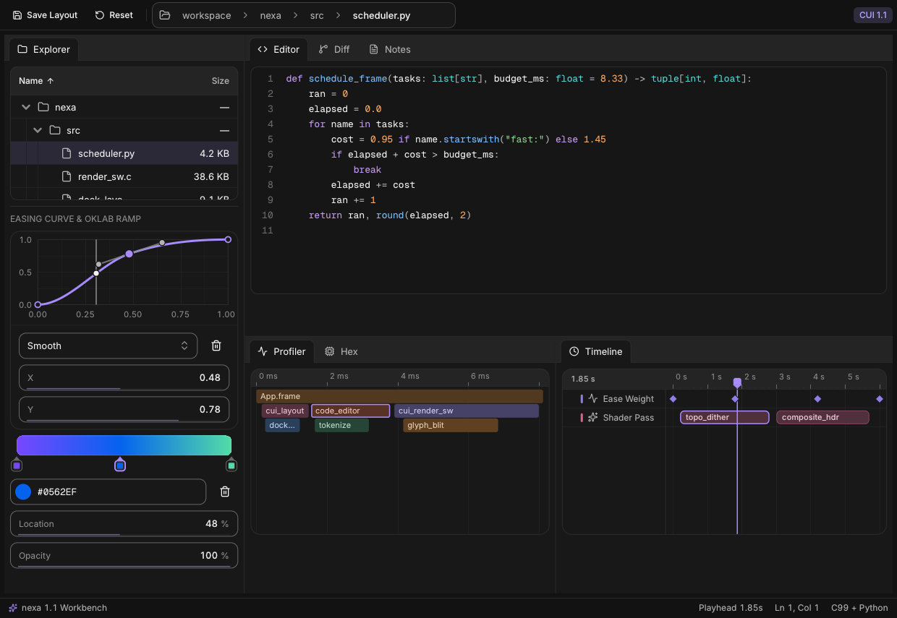

# nexa

**nexa** is a lightweight, high-performance immediate-mode desktop UI library for Python, powered by the zero-dependency C99 [CUI](https://github.com/yappologistic/CUI) layout, spring-animation, and SDF rendering engine.



- **Sub-megabyte native core**: **820 KB** stripped shared library (`libnexa_cui`) including embedded **Inter**, **Geist Mono**, **168 Lucide icons**, OpenGL 3.3 + multi-threaded CPU software rasterizer, PNG/JPEG loader, optional **BiDi & Arabic OpenType text shaping** (`--rtl`), and OS windowing (**660 KB** in minimal LTO builds).
- **Zero runtime Python dependencies**: Pure Python standard library (`ctypes` ABI releasing the GIL on every native call, `__slots__` value types, ~48 ms warm import).
- **160+ components across 20 domains (synced with CUI v1.1)**: Flexbox & grid layouts, multi-split **docking workspaces** (`dockspace`), hierarchical **`tree_table`** & **`path_bar`**, rich CommonMark/GFM **`markdown`**, multi-line **`code_editor`**, side-by-side **`diff_view`**, **`hex_view`**, profiler **`flame_graph`**, **`curve_editor`**, OKLab **`gradient_editor`**, NLE **`timeline_editor`**, virtualized 1M-row lists & editable data grids, 16 chart types, Kanban/Gantt/week calendars, AI agent/chat widgets, media, motion text, property inspector, Bezier node editor, and custom vector canvas.
- **Value-returning Pythonic API with full control**: Widgets accept and return plain Python values (`str`, `bool`, `int`, `float`, `Color`, `Date`) while exposing transition flags (`changed`, `submitted`, `focused`, `blurred`), hit rects, persistent `state_buffer`, custom `Platform` hooks, and `CustomRenderer` GPU callbacks.
- **Functional, Procedural, and OOP styles**: Write concise scripts with `import nexa as ui`, modular procedural apps with `ctx: ui.UI`, or multi-screen architectures with `Application`, `Router`, `View`, `Component`, and `Store`.
- **First-class Concurrency, `asyncio`, & Networking**: 0%-CPU idle sleep with OS-level cross-thread `app.wake()`, `BackgroundRunner` (`submit`, `stream`, `fetch_json`, `fetch_bytes`), MPSC `Channel`, cooperative `await app.run_async(...)`, and threaded `AsyncBridge`.

---

## Documentation & Step-by-Step Guides

Learn `nexa` from scratch in [`docs/`](docs/):

0. **[Zero to Hero: The Complete `nexa` Full Tutorial](docs/zero-to-hero.md)** — Comprehensive 11-module masterclass taking you from your first 15-line native window through Flexbox/Grid layouts, forms & pickers, desktop chrome, 50k virtualized grids, code & diff editors, studio canvases, OOP architecture, OKLCH theming, async worker streams, headless `pytest`, and building **Pulse Studio** (`examples/zero_to_hero.py`).
1. **[Getting Started & Core Mental Model](docs/getting-started.md)** — Installation, value-returning immediate mode, widget IDs & `id_scope`, conditional vs. unconditional `with` scopes, and transition flags.
2. **[Tutorial: Functional & Procedural Coding](docs/tutorial-functional.md)** — Top-level `ui.run(draw)`, flexbox/grid sizing (`FIT`, `FILL`, `GROW`, `PX`, `PCT`), procedural helper decomposition, manual `while app.frame():` loops, and a complete Budget Tracker project.
3. **[Tutorial: Object-Oriented (OOP) Architecture](docs/tutorial-oop.md)** — `Application`, reusable auto-ID-scoped `Component`s, multi-view `Router` & `View` navigation, reactive `Store[T]`, and a complete Incident Console project.
4. **[Theming, Accents, Tones, Colors & Typography](docs/theming-and-styling.md)** — All **8 built-in `Accent` palettes**, **9 semantic `Tone`s**, custom OKLCH/hex `Token` overrides, `.ttf` font loading, and **168 `Icon` constants**.
5. **[Concurrency, Multithreading, `asyncio`, & Networking](docs/concurrency-and-async.md)** — `BackgroundRunner`, token streaming, `Channel`, `LogBuffer`, `await app.run_async(...)`, and `AsyncBridge`.
6. **[Complete 150+ Component Reference](docs/components-reference.md)** — Signatures and usage across all 19 widget domains.
7. **[Custom Canvas, Headless Testing, Custom GPU & Packaging](docs/advanced-rendering-and-packaging.md)** — Vector `canvas`, automated `pytest` UI testing, Vulkan/Metal/`wgpu` `DrawData`, minimal LTO builds, and PyInstaller/Nuitka freezing.

---

## Installation

```bash
pip install .
```

Only a C99 compiler (`gcc`, `clang`, or MSVC `cl`) is required when building from source—**no `python3-dev` headers, CMake, or `libx11-dev` packages are needed** (`libX11.so.6` is loaded dynamically via `dlopen` on Linux, with automatic headless `SoftwareRenderer` fallback on CI/servers without a display).

---

## Quickstart: Functional, OOP, & Headless Styles

Every snippet below is 100% standalone and runnable as-is.

### 1. Functional / Procedural Style

```python
import nexa as ui

def main() -> None:
    count = 0
    name = "world"

    def draw() -> None:
        nonlocal count, name
        with ui.column(width=ui.FILL, height=ui.FILL, pad=24, gap=14, bg=ui.Color.BACKGROUND):
            ui.heading(f"Hello, {name or 'stranger'}!", level=1)
            name = ui.input("name", name, placeholder="Type your name...", clearable=True)
            with ui.row(gap=10, align=ui.Align.CENTER):
                if ui.button("Increment", variant=ui.ButtonVariant.PRIMARY, icon=ui.Icon.PLUS):
                    count += 1
                ui.badge(f"Count: {count}", tone=ui.Tone.ACCENT)

    ui.run(draw, title="Hello — nexa", width=560, height=340, accent=ui.Accent.BLUE)

if __name__ == "__main__":
    main()
```

### 2. Object-Oriented Style (`Application`, `Router`, `View`, `Component`, `Store`)

```python
import nexa as ui

class CounterCard(ui.Component):
    def __init__(self, key: str, title: str) -> None:
        super().__init__(key)
        self.title = title
        self.count = 0

    def build(self, ctx: ui.UI) -> None:
        # Automatic ID-scope isolation: multiple instances never collide!
        with ctx.card(pad=18, gap=10, width=ui.GROW(1)):
            ctx.heading(self.title, level=4)
            if ctx.button("Increment", icon=ui.Icon.PLUS, variant=ui.ButtonVariant.PRIMARY):
                self.count += 1
            ctx.secondary(f"Value: {self.count}")

class DashboardApp(ui.Application):
    def __init__(self) -> None:
        super().__init__("OOP Demo", width=720, height=380, theme=ui.ThemeMode.DARK, accent=ui.Accent.GREEN)

    def setup(self) -> None:
        self.left = CounterCard("left", "Pipeline A")
        self.right = CounterCard("right", "Pipeline B")

    def build(self, ctx: ui.UI) -> None:
        with ctx.row(width=ui.FILL, height=ui.FILL, pad=24, gap=16, bg=ui.Color.BACKGROUND):
            self.left(ctx)
            self.right(ctx)

if __name__ == "__main__":
    DashboardApp().run()
```

### 3. Explicit Headless / Custom GPU Control

```python
import nexa as ui

with ui.SoftwareRenderer(threads=4) as sw:
    with ui.UI(width=800, height=450, theme=ui.ThemeMode.DARK, accent=ui.Accent.VIOLET, renderer=sw) as ctx:
        with ctx.frame(dt=1 / 60):
            with ctx.column(width=ui.FILL, height=ui.FILL, pad=24, gap=12, bg=ui.Color.BACKGROUND):
                ctx.metric("Throughput", "124,800 req/s", delta=14.2, spark=[82, 91, 96, 110, 124])

        # Save directly to PNG or inspect raw 64-byte SDF vertices & draw commands
        ctx.render_to_png("snapshot.png")
        dd = ctx.draw_data()
        print(dd.vertex_count, dd.index_count, len(dd.commands()))
```

---

## Built-In Theme Accents (`ui.Accent`)

`nexa` includes **8 perceptually balanced OKLCH accents** (`ThemeMode.LIGHT` & `ThemeMode.DARK`):

| Accent Enum | Dark Hex | Light Hex |
|---|---|---|
| `ui.Accent.NEUTRAL` | `#e8e8e8` | `#1d1d1d` |
| `ui.Accent.VIOLET` | `#a78bff` | `#7747ff` |
| `ui.Accent.BLUE` *(default)* | `#6ba3ff` | `#0562ef` |
| `ui.Accent.GREEN` | `#53dca6` | `#00864b` |
| `ui.Accent.AMBER` | `#ffcb62` | `#f3ad20` |
| `ui.Accent.ORANGE` | `#ffad5e` | `#c25300` |
| `ui.Accent.CORAL` | `#ff9386` | `#d1403a` |
| `ui.Accent.ROSE` | `#ff8bc5` | `#d23286` |

Need a custom hex or OKLCH brand accent? Set `ctx.theme[ui.Token.ACCENT] = ui.Color.hex("#14b8a6")` at any time—see **[Theming & Styling](docs/theming-and-styling.md)**.

---

## Concurrency, `asyncio`, & Background Streaming

### Cooperative Single-Thread `asyncio`

```python
import asyncio
import nexa as ui

async def main() -> None:
    status = "Connecting..."
    app = ui.App("Async Demo", width=640, height=320, theme=ui.ThemeMode.DARK, accent=ui.Accent.VIOLET)

    async def worker() -> None:
        nonlocal status
        await asyncio.sleep(0.2)
        status = "Live stream active"
        app.wake()

    task = asyncio.create_task(worker())
    try:
        await app.run_async(lambda ctx: ctx.heading(status, level=2))
    finally:
        task.cancel()
        app.close()

if __name__ == "__main__":
    asyncio.run(main())
```

### Background Worker Pool & Token Streaming (`BackgroundRunner`)

```python
import time
import nexa as ui

def main() -> None:
    app = ui.App("Streaming Demo", width=640, height=320, theme=ui.ThemeMode.DARK)
    runner = ui.BackgroundRunner.for_app(app)
    chunks: list[str] = []

    def generate_tokens():
        for word in ["Zero-bloat", "native", "UI", "streaming", "in", "Python!"]:
            time.sleep(0.05)
            yield word

    def draw(ctx: ui.UI) -> None:
        with ctx.column(width=ui.FILL, height=ui.FILL, pad=24, gap=14, bg=ui.Color.BACKGROUND):
            if ctx.button("Stream Response", icon=ui.Icon.SPARKLES, variant=ui.ButtonVariant.PRIMARY):
                chunks.clear()
                runner.stream(generate_tokens, on_item=chunks.append)
            ctx.text(" ".join(chunks) or "Click Stream Response to begin.")

    try:
        app.run(draw)
    finally:
        runner.close()
        app.close()

if __name__ == "__main__":
    main()
```

---

## Examples & Tests

Run any of the **13 complete example apps** in [`examples/`](examples/):

| Example | Highlights |
|---|---|
| [`examples/zero_to_hero.py`](examples/zero_to_hero.py) | **0-to-Hero Capstone (*Pulse Studio*)**: OOP `Application` + `Component` + `Store`, `dockspace`, `path_bar`, `tree_table`, `code_editor`, `diff_view`, GFM `markdown`, `line_chart`, `flame_graph`, `BackgroundRunner` & `command_palette` |
| [`examples/workbench.py`](examples/workbench.py) | **New in 1.1**: Multi-split `dockspace`, `path_bar`, `tree_table`, `code_editor`, `diff_view`, `markdown`, `flame_graph`, `curve_editor`, `gradient_editor`, `timeline_editor` & `hex_view` |
| [`examples/hello.py`](examples/hello.py) | Functional quickstart, `input`, `switch`, `toast`, `theme_toggle` |
| [`examples/notes.py`](examples/notes.py) | Split-view notes editor, search, tags, `dialog`, `command_palette` (`Ctrl+K`) |
| [`examples/settings.py`](examples/settings.py) | OOP `Application` + `Router` + `View` + `Component` + all 8 `Accent` presets |
| [`examples/dashboard.py`](examples/dashboard.py) | KPI `number_roll`, `sparkline`, `line_chart`, `donut_chart`, 250-row `data_grid` |
| [`examples/assistant.py`](examples/assistant.py) | AI workspace + `BackgroundRunner.stream`, `reasoning`, `tool_call`, `voice_orb` |
| [`examples/tracker.py`](examples/tracker.py) | Drag-and-drop `kanban` board, `gantt` timeline, `week_calendar`, `presence` |
| [`examples/finance.py`](examples/finance.py) | Live `ticker`, odometer `counter`, `treemap`, `sankey`, `money_input` |
| [`examples/mail.py`](examples/mail.py) | `swipe_item` inbox, `chip` filters, `comment`, `dropzone`, slide-over `sheet` |
| [`examples/music.py`](examples/music.py) | `carousel`, `now_playing` transport, scrubbable `waveform`, `reorder` queue |
| [`examples/gallery.py`](examples/gallery.py) | IDE `menu_bar`/`toolbar`/`doc_tabs`, Bezier `node_editor`, `canvas`, `inspector`, `LogBuffer` |
| [`examples/async_network.py`](examples/async_network.py) | Cooperative `await app.run_async` + loopback HTTP server + `Channel` |

Render headless screenshots on any machine or CI runner:

```bash
NEXA_HEADLESS=1 CUI_SCREENSHOT=dashboard.png CUI_SCREENSHOT_FRAMES=12 python3 examples/dashboard.py
```

Run the test suite:

```bash
pytest -v
```

---

## License

MIT License. Bundled fonts (Inter, Geist Mono, Lucide) and single-header libraries (`stb_*`) are permissive open-source; see [`LICENSE`](LICENSE) and [`THIRD_PARTY.md`](THIRD_PARTY.md).
