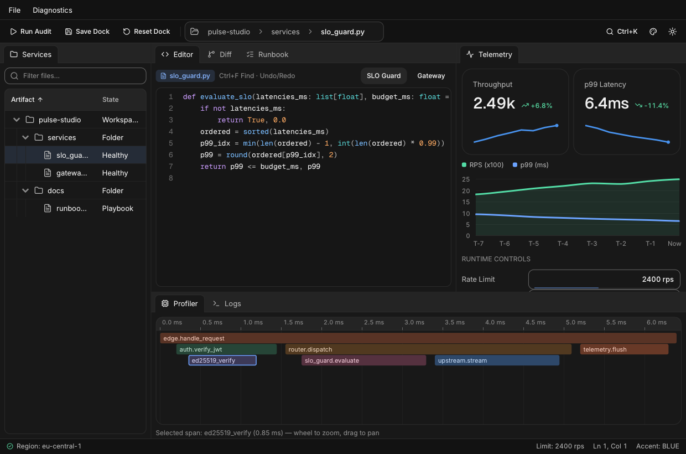

# Zero to Hero: The Complete `nexa` Full Tutorial

Welcome to the complete, end-to-end **Zero to Hero** course for **`nexa`** (`v1.1.0`)—the zero-dependency, C99-backed immediate-mode UI framework for Python.

By the end of this single comprehensive tutorial, you will go from **opening your very first 15-line native window** all the way to **architecting, testing, and packaging a multi-pane desktop IDE & telemetry studio** (*Pulse Studio*) with interactive docking, virtualized tree & data grids, syntax-highlighted code and Myers diff editors, CommonMark/GFM checklists, live charts, flame profilers, background worker streams, and headless `pytest` verification.



### Curriculum Roadmap

| Module | Skill Level | What You Will Master | Milestone App Built |
|---|---|---|---|
| **Module 0** | Level 0 · Zero Setup | Installation, native compilation, value-returning immediate mode, 0% idle CPU, widget IDs (`##`), & `with` scopes | `hello_hero.py` |
| **Module 1** | Level 1 · Layouts | Flexbox (`row`/`column`), `FIT`/`FILL`/`GROW`/`PX`/`PCT`, `spacer`, `stack`, responsive `grid`, `scroll` & draggable `split` | `workspace_shell.py` |
| **Module 2** | Level 2 · Forms & Input | Every text/numeric/money/tag input, switches, sliders, selects, date & color pickers, validation, `disabled_scope` & shortcuts | `deploy_configurator.py` |
| **Module 3** | Level 3 · Chrome & Overlays | `menu_bar`, `toolbar`, `doc_tabs` (dirty/close/reorder), editable `path_bar`, `context_menu`, `dialog`, `sheet`, `toast` & `Ctrl+K` `command_palette` | `scratchpad_chrome.py` |
| **Module 4** | Level 4 · Data, Code & Charts | 50,000-row virtualized `data_grid`, `tree_table`, `markdown` task lists, `code_editor`, `diff_view`, `line_chart` & drag-and-drop `kanban` | `data_and_code_lab.py` |
| **Module 5** | Level 5 · Studio & Canvas | Multi-split `dockspace`, Bezier `node_editor` + `inspector`, `curve_editor`, OKLab `gradient_editor`, `flame_graph`, `hex_view`, `timeline_editor` & custom SDF `canvas` | `studio_instruments.py` |
| **Module 6** | Level 6 · Architecture | Functional (`ui.run`) vs. Procedural (`ctx: ui.UI`) vs. Object-Oriented (`Application`, auto-scoped `Component`, `Router`/`View` & reactive `Store`) | `oop_issue_tracker.py` |
| **Module 7** | Level 7 · Design System | Light/Dark modes, all 8 perceptual OKLCH `Accent`s, 9 `Tone`s, 34 live `Token` overrides, `oklch()`/`mix_colors()`, custom `.ttf` fonts & `--rtl` BiDi | `design_system_lab.py` |
| **Module 8** | Level 8 · Concurrency & AI | GIL-free event sleeping, `app.wake()`, `BackgroundRunner` (`submit` & `stream`), `Channel`, `LogBuffer`, `AsyncBridge` & streaming AI copilot | `streaming_copilot.py` |
| **Module 9** | Level 9 · **HERO CAPSTONE** | Combining OOP + `Store` + `dockspace` + `tree_table` + `code_editor` + `diff_view` + `markdown` + `line_chart` + `flame_graph` + `BackgroundRunner` | **Pulse Studio** (`examples/zero_to_hero.py`) |
| **Module 10** | Level 10 · Test & Ship | Synthetic mouse/keyboard headless `pytest` suites, PNG verification, `CustomRenderer` GPU integration, LTO builds (`660 KB`) & PyInstaller/Nuitka binaries | Production Test & Freeze Recipes |

> **Pro Tip:** Every single complete program in this tutorial is syntactically verified and executed headlessly in CI. You can copy any program into a `.py` file and run `python3 file.py` on Windows, macOS, or Linux—or render it off-screen on a headless server with `NEXA_HEADLESS=1 CUI_SCREENSHOT=out.png CUI_SCREENSHOT_FRAMES=20 python3 file.py`!

---

## Module 0: Zero Setup, First Window & The Immediate-Mode Mental Model

### 0.1 Installation & Zero-Dependency Architecture

Install `nexa` from the repository root (or via `pip`):

```bash
pip install .
```

What happens under the hood?
- **Zero runtime Python dependencies**: `nexa` uses only Python's standard library (`ctypes`, `threading`, `asyncio`, `contextvars`, `dataclasses`).
- **One ~820 KB C99 shared library (`libnexa_cui`)**: Contains all 160+ widgets, Flexbox/CSS-Grid layout, spring physics, OpenGL 3.3 + multi-threaded SIMD CPU `SoftwareRenderer`, embedded **Inter** & **Geist Mono** fonts, and **168 Lucide vector icons**.
- **No `-dev` system header headaches**: You do **not** need `python3-dev`, `cmake`, or `libx11-dev`. On Linux, `nexa` loads `libX11.so.6` dynamically via `dlopen` and falls back seamlessly to its headless CPU renderer on servers or containers.

Whenever you modify C sources or want custom build flags (such as `--rtl` or `--minimal --lto`), rebuild directly via:

```bash
python3 -m nexa.build
```

### 0.2 Milestone 0: Your First Interactive Native Window

Create `hello_hero.py` and run `python3 hello_hero.py`:

```python
import nexa as ui


def main() -> None:
    name = "Explorer"
    clicks = 0
    history: list[str] = []

    def draw() -> None:
        nonlocal name, clicks
        with ui.column(width=ui.FILL, height=ui.FILL, pad=24, gap=14, bg=ui.Color.BACKGROUND):
            # Header row with live title and built-in Sun/Moon theme toggle
            with ui.row(width=ui.FILL, align=ui.Align.CENTER):
                ui.heading(f"Welcome, {name or 'Anonymous'}!", level=1)
                ui.spacer()
                ui.theme_toggle()

            ui.secondary("Edit your name or press Enter inside the input to log a greeting.")

            # Value-returning text input: pass current `str`, receive updated `str`!
            name = ui.input("hero_name", name, label="Developer handle", placeholder="Type a name...", clearable=True)
            if ui.submitted() and name.strip():
                history.append(f"Signed in as @{name.strip()} (#{len(history) + 1})")

            # Value-returning button: returns True on the exact frame it was clicked
            with ui.row(gap=10, align=ui.Align.CENTER):
                if ui.button("Ship Feature", variant=ui.ButtonVariant.PRIMARY, icon=ui.Icon.ROCKET):
                    clicks += 1
                if ui.button("Reset", variant=ui.ButtonVariant.GHOST, disabled=(clicks == 0)):
                    clicks = 0
                ui.badge(f"{clicks} shipped", tone=ui.Tone.SUCCESS if clicks > 0 else ui.Tone.NEUTRAL, dot=True)

            if history:
                ui.separator()
                ui.muted("RECENT SUBMISSIONS")
                for idx, entry in enumerate(history[-4:]):
                    with ui.id_scope(idx):
                        ui.label(entry)

    ui.run(draw, title="Module 0 — Hello Hero", width=560, height=380, accent=ui.Accent.VIOLET)


if __name__ == "__main__":
    main()
```

### 0.3 How `nexa` Works (And Why It Feels Like Superpowers)

If you come from **Tkinter, PyQt, GTK, or wxPython** (retained-mode toolkits), you are used to:
1. Constructing widget objects (`btn = QPushButton(...)`),
2. Attaching callbacks (`btn.clicked.connect(...)`), and
3. Manually keeping widget state (`input_box.setText(...)`) synchronized with your real Python data. Bugs happen whenever those two copies drift out of sync!

If you come from **game-engine immediate-mode UIs**, you might worry about burning 100% CPU spinning in an infinite `while True` loop.

`nexa` gives you the best of both worlds—**Event-Driven, Value-Returning Immediate Mode**:

| Dimension | Retained GUI (Qt / Tkinter) | Game-Loop IMGUI | **`nexa` (Event-Driven IMGUI)** |
|---|---|---|---|
| **Source of truth** | Split between Python & widget objects | Your variables | **Your Python variables only** |
| **Conditional UI** | `.show()` / `.hide()` / reparenting | `if flag:` | **Plain Python `if` / `for` / `match`** |
| **Idle CPU usage** | ~0% | 100% (spins at 60fps forever) | **0% CPU** (blocks on OS events with GIL released!) |
| **Animations** | Manual timers | Per-frame math | **Automatic 60–120fps C99 spring physics** |

When nothing is happening, `nexa` sleeps inside the OS event queue (`0%` CPU). The instant you move the mouse, press a key, trigger a spring animation, or call `app.wake()` from a background thread, `nexa` runs your `draw()` function (~`0.15 ms`), computes Flexbox/Grid layout in a single C99 pass, and renders crisp anti-aliased SDF primitives.

### 0.4 The Three Golden Rules of `nexa`

Memorize these three rules now and you will **never** hit an immediate-mode gotcha:

#### Rule 1: Widget Identity (`id`, `label##hidden`, and `id_scope`)
To track keyboard focus, scroll offsets, and hover springs across frames, `nexa` hashes a 32-bit FNV-1a ID for each interactive widget:
- **Explicit-ID widgets** (`ui.input("email", val)`, `ui.select("role", items, idx)`, `ui.tabs("main_tabs", ...)`) hash that first `id` string.
- **Label-hashed widgets** (`ui.button("Save")`, `ui.checkbox("Enable TLS", tls)`) hash their label string.
- **`Visible##Hidden` syntax**: Everything starting at `##` is **invisible on screen** cleanly disambiguating the hash!
  - `ui.button("Delete##item_1")` and `ui.button("Delete##item_2")` both display **`Delete`**, with distinct IDs.
  - `ui.switch("##row_toggle", active)` renders a clean label-free switch hashed as `"##row_toggle"`.
- **Loops (`with ui.id_scope(key):`)**: Inside any `for` loop that renders interactive controls, wrap each iteration in `with ui.id_scope(row_id):` so every row gets its own isolated ID namespace!

#### Rule 2: Unconditional vs. Conditional `with` Scopes
`nexa` uses Python `with` blocks so you never forget an `end()` call. They come in two flavors:
1. **Unconditional Layout Scopes** (always render children directly inside `with`):
   - `row`, `column`, `box`, `stack`, `grid`, `card`, `scroll`, `split`, `dockspace`
   - `menu_bar`, `toolbar`, `status_bar`, `dialog_footer`, `button_group`, `kanban`, `virtual_list`, `reorder`
   - `id_scope`, `disabled_scope`, `clip_scope`
2. **Conditional Scopes** (**always bind `as s:` and check `if s:` before emitting children!**):
   - Popups & Modals: `dialog`, `sheet`, `popover`, `hover_card`, `menu`, `context_menu`, `user_menu`, `menu_bar_menu`, `path_bar_menu`
   - Disclosures & Panels: `dock_panel`, `accordion`, `expandable_card`, `tree`, `reasoning`
   - Structured Views: `table`, `data_grid`, `tree_table`, `inspector`, `node_editor`

```python
# CORRECT conditional scope pattern:
with ui.dialog("Delete Project?", confirm_open, description="This action cannot be undone.") as dlg:
    if dlg:  # <-- Only build inner widgets when the dialog is actually visible!
        with ui.dialog_footer():
            if ui.button("Cancel", variant=ui.ButtonVariant.GHOST):
                dlg.open = False
            if ui.button("Delete", variant=ui.ButtonVariant.DANGER):
                dlg.open = False
confirm_open = dlg.open  # Captures Escape key & backdrop click automatically!
```

#### Rule 3: Inspecting Per-Widget Transitions (`changed`, `submitted`, `focused`, `blurred`)
Right after any widget call, you can inspect *how* it transitioned on the current frame:
- `ui.changed()` (or `ctx.changed`) — Value changed this frame.
- `ui.submitted()` (or `ctx.submitted`) — User pressed **Enter** inside `input` / `search`.
- `ui.focused()` / `ui.blurred()` — Widget just gained or lost focus this frame.
- `ctx.last_id` & `ctx.last_rect` — Widget's 32-bit ID and previous-frame `Rect(x, y, w, h)` on `ctx: ui.UI`.

---

## Module 1: Layout Mastery — Flexbox, Responsive Grids, Scroll & Split Panes

Every container in `nexa` shares one ultra-fast C99 constraint layout engine. Once you know its **5 sizing primitives** and **alignment axes**, you can construct any desktop layout in minutes without pixel-pushing.

### 1.1 The 5 Sizing Primitives

Pass any of these to `width=` or `height=` on containers and controls:

| Expression | Behavior | Typical Use |
|---|---|---|
| `ui.FIT` *(or `None`)* | Shrink-wraps tightly around child content | Buttons, badges, auto-height cards |
| `ui.FILL` | Expands to 100% of available parent space | Root layout, full-width inputs & panels |
| `ui.GROW(weight=1.0)` | Flex-grows proportionally along a `row` or `column` (`GROW(2)` gets 2× `GROW(1)`) | Main content area above a fixed status bar |
| `240` *(or `ui.PX(240)`)* | Exact logical pixel size (automatically scaled by OS HiDPI `ctx.scale`!) | Fixed `220px` navigation sidebar |
| `ui.PCT(50)` | Percentage (`0..100`) of parent dimension | Half-width split cards |

You can also clamp flexible containers with `min_width=`, `max_width=`, `min_height=`, and `max_height=`.

### 1.2 Alignment, Justification, Spacers, Stacks, Grids & Splits

- **Main-axis distribution (`justify=`)**: `ui.Justify.START`, `CENTER`, `END`, `BETWEEN`, `AROUND`.
- **Cross-axis alignment (`align=`)**: `ui.Align.START`, `CENTER`, `END`, `STRETCH`.
- **Fluid push (`ui.spacer()`)**: Inserts a `GROW(1)` spring inside a `row` or `column`, pushing subsequent items to the far right or bottom!
- **Z-layered `ui.stack(...)`**: Overlaps children in the same box (ideal for corner notification dots on avatars or HUD overlays over a canvas).
- **Responsive `ui.grid(columns=3, min_column_width=180, gap=14)`**: Automatically wraps columns based on window width when `min_column_width > 0`!
- **Draggable `ui.split("id", ratio, vertical=False)`**: Renders an interactive resize handle between two panes; call `sp.next()` between Pane 1 and Pane 2, then save `ratio = sp.ratio` after exiting the `with` block.

### 1.3 Milestone 1: Responsive 3-Pane Desktop Shell

Let's combine a collapsible sidebar, a draggable `split` inspector, a scrollable responsive KPI `grid`, and a `status_bar`:

```python
import nexa as ui


def main() -> None:
    sidebar_collapsed = False
    active_nav = 0
    split_ratio = 0.68
    search_q = ""

    nav_items = [
        ("Cluster Overview", ui.Icon.LAYOUT_DASHBOARD, "6"),
        ("Compute Nodes", ui.Icon.SERVER, "24"),
        ("Deployments", ui.Icon.ROCKET, ""),
        ("Security & Keys", ui.Icon.SHIELD, "1"),
    ]
    metrics = [
        ("API Requests", "148.2k", +12.4, [90, 104, 112, 128, 135, 148]),
        ("Median Latency", "3.8 ms", -8.2, [5.1, 4.8, 4.4, 4.1, 3.9, 3.8]),
        ("Cache Hit Ratio", "99.4%", +0.6, [97.8, 98.4, 98.9, 99.1, 99.3, 99.4]),
        ("Active Streams", "4,096", +4.1, [3400, 3600, 3720, 3890, 4010, 4096]),
        ("Error Budget", "99.98%", +0.02, [99.91, 99.94, 99.95, 99.97, 99.98, 99.98]),
        ("Queue Depth", "14 jobs", -22.0, [42, 35, 29, 24, 18, 14]),
    ]

    def draw(ctx: ui.UI) -> None:
        nonlocal sidebar_collapsed, active_nav, split_ratio, search_q

        with ctx.column(width=ui.FILL, height=ui.FILL, bg=ui.Color.BACKGROUND):
            # 1. Top Header Bar
            with ctx.row(width=ui.FILL, pad_x=16, pad_y=10, gap=10, align=ui.Align.CENTER, bg=ui.Color.SURFACE):
                if ctx.icon_button(ui.Icon.PANEL_LEFT, tooltip="Toggle sidebar"):
                    sidebar_collapsed = not sidebar_collapsed
                ctx.breadcrumb(["Cloud", nav_items[active_nav][0]])
                ctx.spacer()
                search_q = ctx.search("shell_q", search_q, placeholder="Filter metrics...", width=220, size=ui.ControlSize.SM)
                ctx.theme_toggle()

            ctx.separator()

            # 2. Middle Workspace (GROW(1) fills all vertical space above status_bar)
            with ctx.row(width=ui.FILL, height=ui.GROW(1)):
                # Left Sidebar (collapses cleanly from 220px to 56px!)
                side_w = 56 if sidebar_collapsed else 220
                with ctx.column(width=side_w, height=ui.FILL, pad=10, gap=4, bg=ui.Color.SURFACE_MUTED):
                    for idx, (label, icon, count_badge) in enumerate(nav_items):
                        with ctx.id_scope(idx):
                            if sidebar_collapsed:
                                if ctx.icon_button(
                                    icon,
                                    variant=ui.ButtonVariant.SECONDARY if active_nav == idx else ui.ButtonVariant.GHOST,
                                    tooltip=label,
                                ):
                                    active_nav = idx
                            else:
                                if ctx.nav_item(
                                    label,
                                    icon=icon,
                                    badge=count_badge or None,
                                    selected=(active_nav == idx),
                                    group="shell_nav",
                                ):
                                    active_nav = idx

                # Resizable Center + Right Inspector Split
                with ctx.split("main_split", split_ratio, min_first=320, min_second=200, width=ui.FILL, height=ui.FILL) as sp:
                    # Pane 1: Scrollable Responsive KPI Card Grid
                    with ctx.scroll("kpi_scroll", width=ui.FILL, height=ui.FILL, pad=20, gap=16):
                        ctx.heading(nav_items[active_nav][0], level=2)
                        with ctx.grid(columns=3, min_column_width=190, gap=14, width=ui.FILL):
                            for title, val, delta, spark in metrics:
                                if search_q and search_q.lower() not in title.lower():
                                    continue
                                lower_good = "Latency" in title or "Queue" in title
                                ctx.metric(title, val, delta=delta, spark=spark, lower_is_better=lower_good)

                    sp.next()  # <-- Switch from Pane 1 to Pane 2!

                    # Pane 2: Right Details Drawer
                    with ctx.column(width=ui.FILL, height=ui.FILL, pad=16, gap=10, bg=ui.Color.SURFACE):
                        ctx.heading("Inspector", level=4)
                        ctx.secondary(f"Split ratio: {sp.ratio:.2f}")
                        with ctx.card(pad=14, gap=8, muted=True, width=ui.FILL):
                            ctx.badge("All Regions Healthy", tone=ui.Tone.SUCCESS, dot=True)
                            ctx.muted("Drag the vertical divider to resize panes smoothly.")
                split_ratio = sp.ratio

            # 3. Bottom Status Bar
            with ctx.status_bar():
                ctx.status_bar_text("Connected · eu-central-1", icon=ui.Icon.WIFI, tone=ui.Tone.SUCCESS)
                ctx.status_bar_spacer()
                ctx.status_bar_item(f"Sidebar: {'Compact' if sidebar_collapsed else 'Expanded'}")
                ctx.status_bar_item(f"Split: {int(split_ratio * 100)}%")

    ui.run(draw, title="Module 1 — Responsive 3-Pane Shell", width=1020, height=620, theme=ui.ThemeMode.DARK)


if __name__ == "__main__":
    main()
```

---

## Module 2: Forms, Pickers, Validation & Keyboard Shortcuts

Desktop tools live and breathe on rich data entry. Unlike browser forms that require external date/color/money libraries, `nexa` builds **every control natively in C99** with full Tab/Shift+Tab focus rings, clipboard copy/paste, and undo support.

### 2.1 Quick Tour of Form & Picker Families

- **Buttons**: `ui.button(label, variant=..., size=..., icon=..., loading=False, full_width=False)`
  - 7 `ui.ButtonVariant`s: `DEFAULT`, `PRIMARY`, `SECONDARY`, `OUTLINE`, `GHOST`, `DANGER`, `LINK`.
  - 3 `ui.ControlSize`s: `SM`, `MD`, `LG`.
  - Special actions: `icon_button`, `split_button`, `confirm_button` (two-click destructive guard), `hold_button` (press-and-hold radial ring), `copy_button`.
- **Text & Code Inputs**: `input(..., password=True, clearable=True)`, `search`, `textarea`, `inline_edit`, `tag_input`, `otp_input` (`(code, completed)`), `password_strength`.
- **Numeric & Financial**: `number` (spinbox + drag), `money_input` (currency formatting), `slider`, `range_slider` (`(lo, hi)`), `ruler_slider`, `histogram_slider`, `scrub` (Houdini/Blender-style drag-value field), `counter`.
- **Choices & Pickers**: `checkbox`, `switch`, `radio`, `radio_cards`, `segmented`, `toggle_group`, `chip`, `select` (`searchable=True`), `combobox`, `multi_select`, `date_picker` (`ui.Date(y, m, d)`), `date_range_picker`, `time_picker` (`(hour, minute)`), `color_picker`, `dropzone`.
- **Keyboard Shortcuts**: `if ui.shortcut(ui.Mod.CTRL, ui.Key.S): ...` triggers cleanly when no conflicting text input owns the chord, and `ui.kbd("Ctrl+S")` renders styled keycaps!

### 2.2 Milestone 2: Interactive Cloud Deployment Configurator

This standalone app combines text/tag/money inputs, searchable `select`, `segmented`, `range_slider`, `date_picker`, `color_picker`, `disabled_scope`, `shortcut(Mod.CTRL, Key.S)`, and real-time validation:

```python
import nexa as ui


def main() -> None:
    service_name = "checkout-api"
    env_idx = 1  # 0=Staging, 1=Production, 2=Shadow
    region_idx = 0
    autoscale_enabled = True
    min_replicas, max_replicas = 2.0, 12.0
    monthly_cap = 450.00
    tags = ["payments", "pci-tier-1"]
    release_date = ui.Date(2026, 11, 15)
    badge_color = ui.Color.hex("#53dca6")
    api_secret = "sk_live_98a7f6d5c4b3"
    saved_count = 0

    regions = ["eu-central-1 (Frankfurt)", "us-east-1 (Virginia)", "ap-northeast-1 (Tokyo)", "us-west-2 (Oregon)"]

    def draw(ctx: ui.UI) -> None:
        nonlocal service_name, env_idx, region_idx, autoscale_enabled
        nonlocal min_replicas, max_replicas, monthly_cap, tags, release_date, badge_color, api_secret, saved_count

        # Validation rules computed directly from Python state!
        errors: list[str] = []
        if len(service_name.strip()) < 3 or " " in service_name:
            errors.append("Service name must be at least 3 characters with no spaces.")
        if len(api_secret) < 8:
            errors.append("API secret must be at least 8 characters.")

        can_deploy = len(errors) == 0

        if ctx.shortcut(ui.Mod.CTRL, ui.Key.S) and can_deploy:
            saved_count += 1
            ctx.toast("Configuration saved", description=f"Revision #{saved_count} committed.", tone=ui.Tone.SUCCESS)

        with ctx.scroll("form_scroll", width=ui.FILL, height=ui.FILL, pad=24, gap=16):
            with ctx.row(width=ui.FILL, align=ui.Align.CENTER):
                ctx.heading("Service Deployment Configurator", level=2)
                ctx.spacer()
                ctx.kbd("Ctrl+S")
                ctx.theme_toggle()

            if errors:
                ctx.alert("Validation Issues", description=" ".join(errors), tone=ui.Tone.DANGER, icon=ui.Icon.CIRCLE_ALERT)

            with ctx.grid(columns=2, min_column_width=320, gap=16, width=ui.FILL):
                # Left Card: Core Identity & Routing
                with ctx.card(pad=20, gap=12):
                    ctx.heading("1. Identity & Region", level=4)
                    service_name = ctx.input("svc_name", service_name, label="Service slug", clearable=True)
                    env_idx = ctx.segmented("env_seg", ["Staging", "Production", "Shadow"], env_idx, full_width=True)
                    region_idx = ctx.select("region_sel", regions, region_idx, label="Primary Region", searchable=True)
                    tags = list(ctx.tag_input("svc_tags", tags, label="Routing Tags", placeholder="Add tag + Enter"))

                    api_secret = ctx.input("svc_secret", api_secret, label="Signing Secret", password=True)
                    ctx.password_strength(api_secret)

                # Right Card: Scaling, Budget & Schedule
                with ctx.card(pad=20, gap=12):
                    ctx.heading("2. Capacity & Schedule", level=4)
                    autoscale_enabled = ctx.switch(
                        "Horizontal Autoscaling",
                        autoscale_enabled,
                        description="Scale worker pods dynamically from CPU & queue p95.",
                    )
                    # Wrap dependent controls in `disabled_scope` when autoscaling is off!
                    with ctx.disabled_scope(not autoscale_enabled):
                        min_replicas, max_replicas = ctx.range_slider(
                            "Replica Bounds", min_replicas, max_replicas, 1.0, 32.0
                        )
                        ctx.muted(f"Pool range: {int(min_replicas)} → {int(max_replicas)} pods")

                    monthly_cap = ctx.money_input("budget_cap", monthly_cap, label="Monthly Spend Cap", code="USD")

                    with ctx.row(gap=12, align=ui.Align.CENTER):
                        release_date = ctx.date_picker("rel_date", release_date, label="Target Cutover")
                        badge_color = ctx.color_picker("svc_color", badge_color)

            # Action Footer Card
            with ctx.card(pad=16, dir=ui.Direction.ROW, align=ui.Align.CENTER, gap=12, muted=True, width=ui.FILL):
                ctx.badge(["STAGING", "PRODUCTION", "SHADOW"][env_idx], tone=ui.Tone.ACCENT, solid=True)
                ctx.secondary(
                    f"{service_name or '(unnamed)'} · {regions[region_idx].split()[0]} · Cap ${monthly_cap:,.2f}/mo"
                )
                ctx.spacer()
                if ctx.button(
                    "Deploy Release",
                    variant=ui.ButtonVariant.PRIMARY,
                    icon=ui.Icon.ROCKET,
                    disabled=not can_deploy,
                ):
                    saved_count += 1
                    ctx.toast(f"Deployed {service_name}!", description=f"Release #{saved_count} live.", tone=ui.Tone.SUCCESS)

    ui.run(draw, title="Module 2 — Forms, Pickers & Validation", width=920, height=640, accent=ui.Accent.GREEN)


if __name__ == "__main__":
    main()
```

---

## Module 3: Desktop Chrome, Menus, Tabs, Dialogs, Sheets & Command Palette

Real desktop software needs more than forms—it needs **application chrome**: menu bars with keyboard mnemonics, icon toolbars, closable/reorderable document tabs with unsaved-change dots, editable breadcrumb address bars (`path_bar`, new in v1.1!), right-click context menus, slide-over sheets, confirmation dialogs, and a `Ctrl+K` command palette.

### 3.1 How `doc_tabs` & `path_bar` Work

- **`doc_tabs`**: Pass a `list[ui.DocTab(title, icon=..., dirty=bool)]` and `selected` index:
  ```python
  res = ctx.doc_tabs("open_docs", tabs, active_idx)
  active_idx = res.apply_to(tabs)  # Handles select, drag-to-reorder & close in 1 line!
  ```
- **`path_bar` (New in v1.1)**: Renders clickable breadcrumb segments that turn into a live text input when you click the empty bar area!
  - `pb.clicked >= 0`: User clicked segment `pb.clicked`—truncate `segments[pb.clicked + 1:]`.
  - `pb.submitted`: Non-empty `str` when the user typed a custom `/path/to/file` and pressed Enter.

### 3.2 Milestone 3: Multi-Tab Scratchpad with Full Desktop Chrome

```python
import nexa as ui


def main() -> None:
    docs = [
        {"title": "architecture.md", "body": "# System Architecture\n\nEvent-driven C99 core + Python bindings.", "saved": True},
        {"title": "todo.md", "body": "- Ship v1.1 dockspace\n- Add Ctrl+K command palette", "saved": False},
        {"title": "notes.txt", "body": "Right-click anywhere in the editor area for quick actions!", "saved": True},
    ]
    active_idx = 0
    path_segs = ["workspace", "notes", "architecture.md"]
    palette_open = False
    info_sheet_open = False
    pending_close_idx = -1

    commands = [
        ui.Command("New Scratch Tab", icon=ui.Icon.PLUS, group="File", shortcut="Ctrl+N"),
        ui.Command("Mark Current Tab Saved", icon=ui.Icon.SAVE, group="File", shortcut="Ctrl+S"),
        ui.Command("Open Document Properties Sheet", icon=ui.Icon.SLIDERS_HORIZONTAL, group="View"),
        ui.Command("Toggle Light / Dark Theme", icon=ui.Icon.SUN, group="Appearance"),
    ]

    def create_new_tab() -> None:
        nonlocal active_idx
        n = len(docs) + 1
        docs.append({"title": f"untitled_{n}.md", "body": f"# Draft {n}\n", "saved": False})
        active_idx = len(docs) - 1
        path_segs[-1] = docs[active_idx]["title"]

    def draw(ctx: ui.UI) -> None:
        nonlocal active_idx, palette_open, info_sheet_open, pending_close_idx

        if ctx.shortcut(ui.Mod.CTRL, ui.Key.K):
            palette_open = not palette_open
        if ctx.shortcut(ui.Mod.CTRL, ui.Key.N):
            create_new_tab()
        if ctx.shortcut(ui.Mod.CTRL, ui.Key.S) and docs:
            docs[active_idx]["saved"] = True
            ctx.toast(f"Saved {docs[active_idx]['title']}", tone=ui.Tone.SUCCESS)

        with ctx.column(width=ui.FILL, height=ui.FILL, bg=ui.Color.BACKGROUND):
            # 1. Menu Bar
            with ctx.menu_bar():
                with ctx.menu_bar_menu("File") as m:
                    if m:
                        if ctx.menu_item("New Tab", icon=ui.Icon.PLUS, shortcut="Ctrl+N"):
                            create_new_tab()
                        if ctx.menu_item("Save", icon=ui.Icon.SAVE, shortcut="Ctrl+S", disabled=not docs):
                            docs[active_idx]["saved"] = True
                            ctx.toast(f"Saved {docs[active_idx]['title']}", tone=ui.Tone.SUCCESS)
                with ctx.menu_bar_menu("View") as m:
                    if m:
                        if ctx.menu_item("Document Sheet…", icon=ui.Icon.SLIDERS_HORIZONTAL):
                            info_sheet_open = True
                        if ctx.menu_item("Command Palette…", icon=ui.Icon.SEARCH, shortcut="Ctrl+K"):
                            palette_open = True

            # 2. Toolbar + Editable Path Bar
            with ctx.toolbar():
                if ctx.toolbar_button(ui.Icon.PLUS, label="New", tooltip="Create tab (Ctrl+N)"):
                    create_new_tab()
                if ctx.toolbar_button(ui.Icon.SAVE, label="Save", disabled=not docs):
                    docs[active_idx]["saved"] = True
                    ctx.toast(f"Saved {docs[active_idx]['title']}", tone=ui.Tone.SUCCESS)
                ctx.toolbar_separator()

                pb = ctx.path_bar("chrome_path", path_segs, icon=ui.Icon.FOLDER_OPEN, width=340)
                if pb.clicked >= 0:
                    del path_segs[pb.clicked + 1 :]
                elif pb.submitted:
                    parts = [p for p in pb.submitted.strip("/").split("/") if p]
                    if parts:
                        path_segs[:] = parts

                ctx.toolbar_spacer()
                if ctx.toolbar_button(ui.Icon.SLIDERS_HORIZONTAL, label="Inspect"):
                    info_sheet_open = True
                if ctx.toolbar_button(ui.Icon.SEARCH, label="Ctrl+K"):
                    palette_open = True
                ctx.theme_toggle()

            # 3. Reorderable Dirty Document Tabs
            if docs:
                tab_models = [
                    ui.DocTab(d["title"], icon=ui.Icon.FILE_TEXT, dirty=not d["saved"])
                    for d in docs
                ]
                tab_res = ctx.doc_tabs("doc_strip", tab_models, active_idx)
                active_idx = tab_res.selected
                if tab_res.moved and 0 <= tab_res.move_from < len(docs) and 0 <= tab_res.move_to < len(docs):
                    moved_doc = docs.pop(tab_res.move_from)
                    docs.insert(tab_res.move_to, moved_doc)
                path_segs[-1] = docs[active_idx]["title"]

                if tab_res.close >= 0:
                    if not docs[tab_res.close]["saved"]:
                        pending_close_idx = tab_res.close  # Ask confirmation before discarding unsaved edits!
                    else:
                        docs.pop(tab_res.close)
                        active_idx = max(0, min(active_idx, len(docs) - 1))

            # 4. Main Document Body + Right-Click Context Menu
            with ctx.column(width=ui.FILL, height=ui.GROW(1), pad=18, gap=10):
                if not docs:
                    ctx.empty_state(
                        "No Open Documents",
                        description="Create a new scratchpad tab or press Ctrl+K.",
                        icon=ui.Icon.FILE_TEXT,
                    )
                else:
                    cur = docs[active_idx]
                    new_body = ctx.textarea("scratch_editor", cur["body"], width=ui.FILL, height=ui.GROW(1))
                    if new_body != cur["body"]:
                        cur["body"] = new_body
                        cur["saved"] = False

                    # Attach a right-click context_menu to the preceding widget!
                    with ctx.context_menu("editor_ctx") as cm:
                        if cm:
                            if ctx.menu_item("Insert Timestamp Header", icon=ui.Icon.CLOCK):
                                cur["body"] += "\n\n## Entry — 2026-11-07\n"
                                cur["saved"] = False
                            if ctx.menu_item("Mark Saved", icon=ui.Icon.CHECK):
                                cur["saved"] = True

            # 5. Status Bar
            with ctx.status_bar():
                ctx.status_bar_text(f"{len(docs)} open tab(s)", icon=ui.Icon.LAYERS)
                ctx.status_bar_spacer()
                if docs:
                    chars = len(docs[active_idx]["body"])
                    ctx.status_bar_item(f"{chars} chars")
                    ctx.status_bar_item("Saved" if docs[active_idx]["saved"] else "Modified")

        # 6. Slide-Over Sheet Drawer
        with ctx.sheet("Document Inspector", info_sheet_open, side=ui.Side.RIGHT, size=320) as sh:
            if sh and docs:
                cur = docs[active_idx]
                with ctx.column(pad=16, gap=12):
                    cur["title"] = ctx.input("doc_rename", cur["title"], label="Filename")
                    ctx.badge("Clean" if cur["saved"] else "Unsaved Edits", tone=ui.Tone.SUCCESS if cur["saved"] else ui.Tone.WARNING)
                    ctx.muted(f"Lines: {cur['body'].count(chr(10)) + 1}")
        info_sheet_open = sh.open

        # 7. Unsaved Close Confirmation Dialog
        with ctx.dialog(
            "Discard Unsaved Changes?",
            pending_close_idx >= 0,
            description="This tab has unsaved edits. Close anyway?",
        ) as dlg:
            if dlg:
                with ctx.dialog_footer():
                    if ctx.button("Keep Open", variant=ui.ButtonVariant.GHOST):
                        pending_close_idx = -1
                        dlg.open = False
                    if ctx.button("Discard & Close", variant=ui.ButtonVariant.DANGER):
                        if 0 <= pending_close_idx < len(docs):
                            docs.pop(pending_close_idx)
                            active_idx = max(0, min(active_idx, len(docs) - 1))
                        pending_close_idx = -1
                        dlg.open = False
        if not dlg.open:
            pending_close_idx = -1

        # 8. Ctrl+K Command Palette
        palette_open, cmd = ctx.command_palette(palette_open, commands)
        if cmd == 0:
            create_new_tab()
        elif cmd == 1 and docs:
            docs[active_idx]["saved"] = True
        elif cmd == 2:
            info_sheet_open = True
        elif cmd == 3:
            ctx.theme_mode = ui.ThemeMode.LIGHT if ctx.theme_mode == ui.ThemeMode.DARK else ui.ThemeMode.DARK

    ui.run(draw, title="Module 3 — Desktop Chrome & Overlays", width=940, height=600, theme=ui.ThemeMode.DARK)


if __name__ == "__main__":
    main()
```

---

## Module 4: High-Density Data, Markdown, Code Editor, Diffs & Charts

One of `nexa`'s biggest advantages over Electron or pure-Python GUI toolkits is **raw data throughput**:
- **`virtual_list` & `data_grid`** only construct widgets for the ~20 rows currently visible on screen (`for r in grid.rows:`), letting you scroll **50,000 to 1,000,000 rows** at 120fps with zero lag!
- **`tree_table`** (v1.1) brings the same virtualization to hierarchical trees with indent guides, column sorting (`ui.tree_sort`), and keyboard navigation.
- **`code_editor`**, **`diff_view`** (+ headless `ui.diff_compute` / `ui.diff_words`), and **`markdown`** (+ interactive GFM checklists via `res.apply_task`) give you full developer-grade document & source tools out of the box.

> **Pitfall to Avoid:** On `code_editor`, `diff_view`, `flame_graph`, `hex_view`, `curve_editor`, and `timeline_editor`, `width=` accepts `SizeLike` (`ui.FILL` or pixels), whereas `height=` expects a concrete `float` pixel height (e.g., `height=320`).

### 4.1 Milestone 4: 50,000-Row Data Grid, Code/Diff/Markdown & Kanban Lab

```python
import nexa as ui


BASELINE_SNIPPET = """\
def batch_score(records: list[float]) -> float:
    return sum(records) / max(1, len(records))
"""

EDITED_SNIPPET = """\
def batch_score(records: list[float], trim: int = 2) -> float:
    if len(records) <= trim * 2:
        return sum(records) / max(1, len(records))
    core = sorted(records)[trim:-trim]
    return round(sum(core) / len(core), 4)
"""

NOTES_MD = """\
### Sprint Verification Notes

- [x] Benchmark 50,000-row virtualized `data_grid` at < 0.2 ms/frame
- [x] Verify Myers `diff_view` intraline word highlights
- [ ] Move validated cards to **Shipped** on the Kanban tab
"""


def main() -> None:
    tab_idx = 0
    row_count = 50_000
    edits: dict[int, str] = {}
    grid_sort = ui.TableSort(0, False)
    grid_cursor = 0

    code_src = EDITED_SNIPPET
    md_src = NOTES_MD

    # Kanban columns: list of (column_title, tone_hex, cards_list)
    columns = [
        ("Backlog", "#6ba3ff", [(101, "Add Parquet export"), (102, "Add CSV clipboard copy")]),
        ("In Review", "#ffcb62", [(103, "Trimmed mean scorer"), (104, "50k row virtualizer")]),
        ("Shipped", "#53dca6", [(105, "CUI 1.1 ABI bridge")]),
    ]

    def find_and_move_card(mv: ui.KanbanMove) -> None:
        src_cards = columns[mv.from_column][2]
        dst_cards = columns[mv.to_column][2]
        for idx, card_tuple in enumerate(src_cards):
            if card_tuple[0] == mv.card:
                item = src_cards.pop(idx)
                dst_cards.insert(min(mv.to_index, len(dst_cards)), item)
                break

    def draw(ctx: ui.UI) -> None:
        nonlocal tab_idx, grid_sort, grid_cursor, code_src, md_src

        with ctx.column(width=ui.FILL, height=ui.FILL, pad=18, gap=12, bg=ui.Color.BACKGROUND):
            with ctx.row(width=ui.FILL, align=ui.Align.CENTER):
                ctx.heading("Data, Code & Planning Lab", level=2)
                ctx.spacer()
                tab_idx = ctx.tabs(
                    "lab_tabs",
                    ["50k Data Grid", "Code & Diff", "Markdown & Charts", "Kanban Board"],
                    tab_idx,
                    variant=ui.TabsVariant.PILL,
                )
                ctx.theme_toggle()

            # Tab 0: 50,000-Row Virtualized Spreadsheet Data Grid
            if tab_idx == 0:
                ctx.secondary("Only visible rows are materialized per frame—double-click any Note cell to edit inline!")
                cols = [
                    ui.GridColumn("Row #", width=90, sortable=True, fixed=True),
                    ui.GridColumn("Service", width=160, sortable=True),
                    ui.GridColumn("Latency", width=110, align=ui.TextAlign.RIGHT),
                    ui.GridColumn("Editable Note (Double-Click)", width=320, priority=1),
                ]
                with ctx.data_grid(
                    "massive_grid",
                    cols,
                    row_count,
                    width=ui.FILL,
                    height=ui.GROW(1),
                    striped=True,
                    sort=grid_sort,
                    cursor=grid_cursor,
                    hide_checkboxes=True,
                ) as grid:
                    if grid:
                        for r in grid.rows:  # <-- Only ~18 visible indices out of 50,000!
                            idx = (row_count - 1 - r) if (grid.sort and grid.sort.descending) else r
                            grid.row(r)
                            grid.cell_text(f"#{idx:05d}")
                            grid.cell_text(["edge-gw", "auth-svc", "billing-db", "search-idx"][idx % 4])
                            grid.cell_text(f"{1.8 + (idx % 17) * 0.35:.2f} ms")
                            cur_note = edits.get(idx, "Nominal throughput")
                            new_note = grid.cell_edit(cur_note)
                            if new_note != cur_note:
                                edits[idx] = new_note
                if grid.sort is not None:
                    grid_sort = grid.sort
                grid_cursor = grid.cursor

            # Tab 1: Live Code Editor + Side-by-Side Myers Diff
            elif tab_idx == 1:
                _, stats = ui.diff_compute(BASELINE_SNIPPET, code_src)
                ctx.badge(f"Live Diff: +{stats.added} / -{stats.removed} lines across {stats.hunks} hunk(s)", tone=ui.Tone.ACCENT)
                with ctx.grid(columns=2, min_column_width=360, gap=12, width=ui.FILL):
                    ed = ctx.code_editor("lab_editor", code_src, lang="python", width=ui.FILL, height=420)
                    code_src = ed.text
                    ctx.diff_view(
                        "lab_diff",
                        BASELINE_SNIPPET,
                        code_src,
                        mode=ui.DiffMode.SPLIT,
                        language="python",
                        old_title="baseline.py",
                        new_title="working.py",
                        width=ui.FILL,
                        height=420,
                    )

            # Tab 2: Interactive GFM Markdown + Native Charts
            elif tab_idx == 2:
                with ctx.grid(columns=2, min_column_width=340, gap=16, width=ui.FILL):
                    with ctx.card(pad=16, gap=10):
                        md_res = ctx.markdown("sprint_md", md_src, width=ui.FILL)
                        if md_res.task_toggled:
                            md_src = md_res.apply_task(md_src)
                    with ctx.card(pad=16, gap=12):
                        ctx.heading("Latency Percentile Trend", level=4)
                        ctx.line_chart(
                            "p99_trend",
                            [
                                ui.Series("p50 (ms)", [2.1, 2.0, 1.9, 1.8, 1.7, 1.6], "#53dca6"),
                                ui.Series("p99 (ms)", [8.4, 7.9, 7.1, 6.4, 5.8, 5.2], "#a78bff"),
                            ],
                            labels=["Mon", "Tue", "Wed", "Thu", "Fri", "Sat"],
                            width=ui.FILL,
                            height=220,
                            area=True,
                            smooth=True,
                        )

            # Tab 3: Drag-and-Drop Kanban Board
            else:
                with ctx.kanban("sprint_kanban") as board:
                    for col_title, dot_hex, cards in columns:
                        with board.column(col_title, len(cards), dot=dot_hex, width=280):
                            for cid, ctitle in cards:
                                with board.card(cid):
                                    ctx.label(ctitle)
                                    ctx.muted(f"TASK-{cid}")
                if board.move is not None:
                    find_and_move_card(board.move)

    ui.run(draw, title="Module 4 — Data, Code, Diff & Kanban", width=1060, height=640, theme=ui.ThemeMode.DARK)


if __name__ == "__main__":
    main()
```

---

## Module 5: Studio & Creative Tools — Dockspace, Node Graphs, Curves, Timelines & Custom SDF Canvas

With CUI v1.1 synced into `nexa`, you can build full **game-engine, audio/video NLE, debugger, and hardware instrumentation studios**:

1. **`dockspace` & `dock_panel`**: Multi-split tabbed workspaces! Pass a compact layout string like `"h0.32([*Graph,Hex],v0.55([*Canvas],[*Timeline,Flame]))"`:
   - `h<ratio>(A,B)` splits horizontally (`left`, `right`); `v<ratio>(A,B)` splits vertically (`top`, `bottom`).
   - `[PanelA,*ActivePanel,-HiddenPanel]` creates a tab group where `*` marks the initially selected tab.
   - Users can drag any panel tab to re-dock or split interactively, and `ctx.dock_save("id")` / `ctx.dock_load("id", layout)` serializes the entire workspace!
2. **`node_editor` + `inspector`**: Pan/zoom Bezier node graphs (`ed.node`, `ed.input`, `ed.output`, `ed.content`, `ed.link`) paired with Houdini/Unity-style property sheets (`prop_float`, `prop_color`, `prop_bool`, `prop_enum`).
3. **`curve_editor` + `gradient_editor` + `timeline_editor`**: Evaluate your Bezier curves and perceptual OKLab color stops directly on any `x` in `[0, 1]` via `ui.curve_eval(keys, x)` and `ui.gradient_eval(stops, t)`!
4. **Custom Vector `canvas`**: Reserve layout space with `ctx.canvas("id", width, height, paint_fn)` and draw anti-aliased SDF shapes (`draw_rect_gradient`, `draw_polyline`, `draw_circle`, `draw_arc`, `draw_text`).

### 5.1 Milestone 5: Interactive Synth Node Studio & Live SDF Oscilloscope

```python
import math
import nexa as ui


def main() -> None:
    node_view = ui.NodeView(0.0, 0.0, 1.0)
    node_pos = {1: [30.0, 40.0], 2: [270.0, 55.0]}
    links: list[tuple[int, int, int]] = [(1, 102, 201)]
    next_link_id = 2

    freq_hz = 3.0
    amp = 0.72
    curve_keys = [
        ui.CurveKey(0.0, 0.1, out_dx=0.25, out_dy=0.0, mode=ui.CurveMode.SMOOTH),
        ui.CurveKey(0.5, 0.95, in_dx=-0.15, in_dy=0.0, out_dx=0.15, out_dy=0.0, mode=ui.CurveMode.SMOOTH),
        ui.CurveKey(1.0, 0.2, in_dx=-0.25, in_dy=0.0, mode=ui.CurveMode.SMOOTH),
    ]
    grad_stops = [
        ui.GradientStop(0.0, "#7747ff"),
        ui.GradientStop(0.5, "#0562ef"),
        ui.GradientStop(1.0, "#53dca6"),
    ]
    packet = bytearray(b"\x4e\x45\x58\x41\x01\x10\x00\xff\x20\x40\x80\xc0\xff\x00\x55\xaa")
    tracks = [
        ui.TimelineTrack(
            "Modulation",
            icon=ui.Icon.ACTIVITY,
            color=1,
            clips=[ui.TimelineClip(0.5, 4.2, name="intro_sweep", selected=True), ui.TimelineClip(4.8, 8.5, name="drop")],
        )
    ]
    playhead = 2.4

    layout = "h0.44([*Graph,Hex],v0.58([*Oscilloscope],[*Timeline]))"

    def draw(ctx: ui.UI) -> None:
        nonlocal node_view, next_link_id, freq_hz, amp, playhead

        with ctx.column(width=ui.FILL, height=ui.FILL, pad=6, bg=ui.Color.BACKGROUND):
            with ctx.dockspace("synth_dock", layout=layout, width=ui.FILL, height=ui.FILL):
                # 1. Node Graph + Curve & Gradient Controls
                with ctx.dock_panel("Graph", icon=ui.Icon.GIT_BRANCH) as p:
                    if p:
                        with ctx.column(width=ui.FILL, height=ui.FILL, pad=8, gap=8):
                            with ctx.node_editor("synth_nodes", node_view, width=ui.FILL, height=250, no_minimap=True) as ed:
                                if ed:
                                    with ed.node(1, node_pos[1][0], node_pos[1][1], "Oscillator", width=185, icon=ui.Icon.AUDIO_LINES) as n1:
                                        with ed.content():
                                            freq_hz = ctx.slider("Hz", freq_hz, 0.5, 10.0, show_value=True, format="%.1f")
                                        ed.output(102, "Signal Out")
                                    node_pos[1] = [n1.x, n1.y]

                                    with ed.node(2, node_pos[2][0], node_pos[2][1], "Envelope", width=185, icon=ui.Icon.SLIDERS_HORIZONTAL) as n2:
                                        ed.input(201, "Signal In")
                                        with ed.content():
                                            amp = ctx.slider("Gain", amp, 0.1, 1.0, show_value=True, format="%.2f")
                                    node_pos[2] = [n2.x, n2.y]

                                    for lid, a_pin, b_pin in links:
                                        ed.link(lid, a_pin, b_pin)
                            node_view = ed.view
                            for a_pin, b_pin in ed.created_links:
                                links.append((next_link_id, a_pin, b_pin))
                                next_link_id += 1

                            ctx.muted("ENVELOPE CURVE & OKLAB COLOR RAMP")
                            ctx.curve_editor("env_curve", curve_keys, width=ui.FILL, height=120)
                            ctx.gradient_editor("wave_grad", grad_stops, width=ui.FILL)

                # 2. Editable Binary Hex Inspector
                with ctx.dock_panel("Hex", icon=ui.Icon.CPU) as p:
                    if p:
                        ctx.hex_view(
                            "firmware_hex",
                            packet,
                            editable=True,
                            ranges=[ui.HexRange(0, 4, tone=ui.Tone.ACCENT, label="Header")],
                            width=ui.FILL,
                            height=360,
                        )

                # 3. Custom SDF Vector Canvas driven by Curve + OKLab Gradient!
                with ctx.dock_panel("Oscilloscope", icon=ui.Icon.ACTIVITY) as p:
                    if p:
                        def paint_wave(c: ui.UI, r: ui.Rect) -> None:
                            with c.clip_scope(r):
                                c.draw_rect_gradient(r, "#0b1020", "#131c33", radius=10)
                                steps = 96
                                pts: list[tuple[float, float]] = []
                                for i in range(steps + 1):
                                    t = i / steps
                                    env = ui.curve_eval(curve_keys, t)
                                    y = r.y + r.h * 0.5 - math.sin(t * math.tau * freq_hz + playhead) * (r.h * 0.38) * amp * env
                                    pts.append((r.x + t * r.w, y))
                                wave_col = ui.gradient_eval(grad_stops, (playhead % 10.0) / 10.0)
                                c.draw_polyline(pts, wave_col, thickness=2.6)
                                c.draw_text(
                                    f"SDF Vector Synth · {freq_hz:.1f} Hz · Playhead {playhead:.2f}s",
                                    (r.x + 14, r.y + 12),
                                    "#e2e8f0",
                                    size=13,
                                )

                        with ctx.column(width=ui.FILL, height=ui.FILL, pad=8):
                            ctx.canvas("wave_canvas", ui.FILL, ui.FILL, paint_wave)

                # 4. Multi-Track NLE Timeline
                with ctx.dock_panel("Timeline", icon=ui.Icon.CLOCK) as p:
                    if p:
                        tl = ctx.timeline_editor("synth_tl", tracks, playhead, start=0.0, end=10.0, width=ui.FILL, height=180)
                        playhead = tl.time

    ui.run(draw, title="Module 5 — Studio Dockspace, Nodes & SDF Canvas", width=1120, height=680, theme=ui.ThemeMode.DARK)


if __name__ == "__main__":
    main()
```

---

## Module 6: Scaling Architecture — Functional vs. Procedural vs. Object-Oriented

`nexa` is uniquely ergonomic because **all three Python paradigms are first-class citizens** and call the **exact same widget names**:

| Style | Entry Point | When to Choose It |
|---|---|---|
| **1. Functional** | `ui.run(draw)` | Quick utilities, scripts, single-file tools (< 250 lines) |
| **2. Procedural** | `with ui.App(...) as app: while app.frame():` | Explicit `ctx: ui.UI` helper modules, multi-window apps, custom loops |
| **3. Object-Oriented** | `class MyApp(ui.Application):` | Multi-screen desktop products, reusable `Component` libraries, shared `Store[T]` |

### 6.1 The 4 Pillars of `nexa`'s OOP Layer

1. **`ui.Application`**: Manages your window (`self.app`), `self.ui`, thread-pool `self.runner`, lazy `self.async_bridge`, and `self.router`. Override `setup(self)`, `build(self, ctx)`, and optional `on_close(self)`.
2. **`ui.Component(key)`**: Every instance **automatically pushes `self.key` onto CUI's ID stack** when called (`self.my_card(ctx)`). Two `Component` instances can render identically labeled `"Save"` or `"Delete"` buttons with **zero ID collisions**! Plus, `on_mount(self, ctx)` runs once before the first render, and `build(self, ctx)` can return values directly to the parent!
3. **`ui.Router` & `ui.View`**: Register named screens (`self.router.register("detail", DetailView("detail"))`), navigate with parameters (`self.router.push("detail", issue_id=42)`), receive parameters in `on_enter(self, params: dict)`, and get instant browser-style `self.router.back()` / `self.router.forward()` history!
4. **`ui.Store[T]`**: Observable state container (`store = ui.Store(AppState(), wake=self.app.wake)`). Read `store.value`, mutate via `store.update(fn)` or `store.value = ...`, and subscribe listeners via `store.subscribe(cb)`.

### 6.2 Milestone 6: Multi-Screen OOP Issue Tracker (`Application` + `Component` + `Router` + `Store`)

```python
import dataclasses
import nexa as ui


@dataclasses.dataclass
class Issue:
    id: int
    title: str
    owner: str
    done: bool = False


class IssueCard(ui.Component):
    """Reusable OOP Component: auto-scopes its widget IDs via `super().__init__(key)`!"""

    def __init__(self, key: str, issue: Issue) -> None:
        super().__init__(key)
        self.issue = issue

    def build(self, ctx: ui.UI) -> bool:
        """Render card and return True if the user clicked 'Inspect →'."""
        open_detail = False
        with ctx.card(pad=14, gap=8, width=ui.FILL):
            with ctx.row(align=ui.Align.CENTER, gap=10):
                # Notice every card uses the exact same "##done" & "Inspect →" labels without colliding!
                self.issue.done = ctx.checkbox("##done", self.issue.done)
                ctx.heading(f"#{self.issue.id} · {self.issue.title}", level=4)
                ctx.spacer()
                ctx.badge(
                    "Resolved" if self.issue.done else "Open",
                    tone=ui.Tone.SUCCESS if self.issue.done else ui.Tone.WARNING,
                )
                if ctx.button("Inspect →", size=ui.ControlSize.SM, variant=ui.ButtonVariant.GHOST):
                    open_detail = True
        return open_detail


class BoardView(ui.View):
    def __init__(self, store: ui.Store[list[Issue]], router: ui.Router) -> None:
        super().__init__("board_view")
        self.store = store
        self.router = router
        self.new_title = ""
        self.cards = {it.id: IssueCard(f"issue_{it.id}", it) for it in store.value}

    def build(self, ctx: ui.UI) -> None:
        issues = self.store.value
        with ctx.column(width=ui.FILL, height=ui.FILL, pad=20, gap=12):
            with ctx.row(width=ui.FILL, gap=8, align=ui.Align.CENTER):
                self.new_title = ctx.input("new_issue", self.new_title, placeholder="Add new issue and press Enter...", width=ui.GROW(1))
                submitted_enter = ctx.submitted
                if (submitted_enter or ctx.button("Add Issue", variant=ui.ButtonVariant.PRIMARY, icon=ui.Icon.PLUS)) and self.new_title.strip():
                    nxt_id = max((x.id for x in issues), default=100) + 1
                    created = Issue(nxt_id, self.new_title.strip(), owner="alex")
                    self.store.update(lambda lst: lst.append(created))
                    self.cards[nxt_id] = IssueCard(f"issue_{nxt_id}", created)
                    self.new_title = ""

            with ctx.scroll("issues_scroll", width=ui.FILL, height=ui.GROW(1), gap=10):
                for item in issues:
                    if self.cards[item.id](ctx):
                        self.router.push("detail", issue_id=item.id)


class DetailView(ui.View):
    def __init__(self, store: ui.Store[list[Issue]], router: ui.Router) -> None:
        super().__init__("detail_view")
        self.store = store
        self.router = router
        self.issue_id = -1

    def on_enter(self, params: dict) -> None:
        self.issue_id = int(params.get("issue_id", -1))

    def build(self, ctx: ui.UI) -> None:
        found = next((x for x in self.store.value if x.id == self.issue_id), None)
        with ctx.column(width=ui.FILL, height=ui.FILL, pad=24, gap=14):
            if found is None:
                ctx.alert("Issue not found", tone=ui.Tone.DANGER)
                return
            ctx.badge(f"ISSUE #{found.id}", tone=ui.Tone.ACCENT)
            found.title = ctx.input("edit_title", found.title, label="Issue Title")
            found.owner = ctx.input("edit_owner", found.owner, label="Assignee")
            found.done = ctx.switch("Mark as Resolved", found.done)
            if ctx.button("← Back to Issue Board", icon=ui.Icon.ARROW_LEFT):
                self.router.back()


class IssueTrackerApp(ui.Application):
    title = "Module 6 — OOP Router, View, Component & Store"
    width = 820
    height = 520
    theme = ui.ThemeMode.DARK
    accent = ui.Accent.VIOLET

    def setup(self) -> None:
        initial_issues = [
            Issue(101, "Sync CUI v1.1 multi-split dockspace", "sara", done=True),
            Issue(102, "Write Zero-to-Hero comprehensive tutorial", "alex", done=False),
            Issue(103, "Add headless PNG snapshot assertions", "mina", done=False),
        ]
        self.store = ui.Store(initial_issues, wake=self.app.wake)
        self.router.register("board", BoardView(self.store, self.router))
        self.router.register("detail", DetailView(self.store, self.router))

    def build(self, ctx: ui.UI) -> None:
        with ctx.column(width=ui.FILL, height=ui.FILL, bg=ui.Color.BACKGROUND):
            with ctx.toolbar():
                if ctx.toolbar_button(ui.Icon.ARROW_LEFT, disabled=not self.router.can_go_back, tooltip="Back"):
                    self.router.back()
                if ctx.toolbar_button(ui.Icon.ARROW_RIGHT, disabled=not self.router.can_go_forward, tooltip="Forward"):
                    self.router.forward()
                ctx.toolbar_separator()
                open_cnt = sum(1 for x in self.store.value if not x.done)
                ctx.badge(f"{open_cnt} open", tone=ui.Tone.ACCENT)
                ctx.toolbar_spacer()
                ctx.theme_toggle()

            # Render whichever `ui.View` is active on the Router stack!
            self.router.render(ctx)


if __name__ == "__main__":
    IssueTrackerApp().run()
```

---

## Module 7: Design System Mastery — Themes, 8 OKLCH Accents, 34 Tokens, Fonts & BiDi (`--rtl`)

### 7.1 All 8 Calibrated OKLCH `ui.Accent`s & 9 Semantic `ui.Tone`s

- **`ui.Accent` (`0..7`)** recolors the window's primary interactive highlight:
  `NEUTRAL`, `VIOLET`, `BLUE` *(default)*, `GREEN`, `AMBER`, `ORANGE`, `CORAL`, and `ROSE`.
- **`ui.Tone`** colors semantic status badges, alerts, banners, timelines, and toasts independently of the window accent:
  `NEUTRAL`, `INFO`, `SUCCESS`, `WARNING`, `DANGER`, `VIOLET`, `TEAL`, `ROSE`, and `ACCENT`.

### 7.2 Live Token Customization, Perceptual OKLCH Math, Custom Fonts & RTL Shaping

Want your own custom hex or OKLCH brand palette, custom corner radii, or custom `.ttf` typography?
- **Mutate any of the 34 `ui.Token` slots live**: `ctx.theme[ui.Token.ACCENT] = ui.oklch(0.72, 0.16, hue_deg)`!
- **Mix colors perceptually in OKLab space** (never muddy sRGB gray): `ui.mix_colors(a, b, 0.35)` and `ui.with_alpha(col, 0.20)`.
- **Custom `.ttf` fonts & fallback chains**:
  ```python
  fid = ctx.font_load_file("assets/JetBrainsMono-Regular.ttf")
  ctx.font_set_role(ui.FontRole.MONO, fid)
  ctx.font_add_fallback(ui.FontRole.BODY, ctx.font_load_file("assets/NotoSansArabic-Regular.ttf"))
  ```
- **Unicode UAX #9 BiDi & Arabic OpenType Shaping (New in v1.1)**: Build with `python3 -m nexa.build --rtl` (or `NEXA_TEXT_SHAPING=1`) and query `bool(ui.build_features() & ui.BuildFeatures.TEXT_SHAPING)` at runtime!

### 7.3 Milestone 7: Interactive OKLCH Theme & Token Studio

```python
import nexa as ui


def main() -> None:
    use_custom_brand = False
    hue_deg = 172.0
    chroma = 0.15
    radius = 10.0
    scale = 1.0

    def draw(ctx: ui.UI) -> None:
        nonlocal use_custom_brand, hue_deg, chroma, radius, scale

        ctx.theme.radius_control = radius
        ctx.theme.radius_surface = radius + 4.0
        ctx.set_font_scale(scale)

        if use_custom_brand:
            brand = ui.oklch(0.70 if ctx.theme_mode == ui.ThemeMode.DARK else 0.55, chroma, hue_deg)
            ctx.theme[ui.Token.ACCENT] = brand
            ctx.theme[ui.Token.ACCENT_SUBTLE] = ui.with_alpha(brand, 0.16)

        with ctx.column(width=ui.FILL, height=ui.FILL, pad=24, gap=16, bg=ui.Color.BACKGROUND):
            with ctx.row(width=ui.FILL, align=ui.Align.CENTER):
                ctx.heading("OKLCH Design System Studio", level=2)
                ctx.spacer()
                ctx.theme_toggle()

            # 8 Built-in Accents Switcher
            accent_labels = [ui.accent_name(a).capitalize() for a in ui.Accent]
            picked = ctx.segmented("accent_bar", accent_labels, int(ctx.accent), full_width=True)
            if picked != int(ctx.accent):
                use_custom_brand = False
                ctx.accent = ui.Accent(picked)

            with ctx.grid(columns=2, min_column_width=320, gap=16, width=ui.FILL):
                with ctx.card(pad=18, gap=12):
                    ctx.heading("Live Token & Geometry Overrides", level=4)
                    use_custom_brand = ctx.switch("Override Token.ACCENT with custom OKLCH", use_custom_brand)
                    with ctx.disabled_scope(not use_custom_brand):
                        hue_deg = ctx.slider("OKLCH Hue (°)", hue_deg, 0.0, 360.0, show_value=True, format="%.0f°")
                        chroma = ctx.slider("OKLCH Chroma", chroma, 0.02, 0.26, show_value=True, format="%.2f")
                    radius = ctx.slider("Corner Radius (px)", radius, 0.0, 20.0, step=1.0, show_value=True, format="%.0f px")
                    scale = ctx.slider("Typography Scale", scale, 0.85, 1.25, step=0.05, show_value=True, format="%.2fx")

                with ctx.card(pad=18, gap=12):
                    ctx.heading("All 9 Semantic Tones", level=4)
                    with ctx.row(gap=8, wrap=True):
                        for tone in ui.Tone:
                            ctx.badge(tone.name, tone=tone, dot=True)
                    ctx.separator()
                    with ctx.row(gap=8):
                        ctx.button("Primary Action", variant=ui.ButtonVariant.PRIMARY, icon=ui.Icon.SPARKLES)
                        ctx.button("Secondary", variant=ui.ButtonVariant.SECONDARY)
                        ctx.button("Outline", variant=ui.ButtonVariant.OUTLINE)

    ui.run(draw, title="Module 7 — OKLCH Design System Studio", width=900, height=520, theme=ui.ThemeMode.DARK)


if __name__ == "__main__":
    main()
```

---

## Module 8: Concurrency, Worker Pools, Streaming AI & Cooperative `asyncio`

Never call `time.sleep(...)`, `urllib.request.urlopen(...)`, or heavy CPU inference directly inside `draw()`—that blocks the UI thread! Instead, `nexa` gives you **four zero-boilerplate concurrency primitives** that wake the sleeping C99 event loop in microseconds via `app.wake()`:

1. **`BackgroundRunner.for_app(app)`** (or `self.runner` on `ui.Application`):
   - `runner.submit(fn, *args, on_done=..., on_error=...)` — Runs `fn` on a worker thread and dispatches `on_done(result)` safely on the **main UI thread**!
   - `runner.stream(gen_fn, *args, on_item=..., on_done=...)` — Iterates a blocking generator on a worker thread and delivers every yielded chunk/token to `on_item(chunk)` on the UI thread!
2. **`ui.Channel[T](wake=app.wake)`**: Lock-free-feel thread-safe queue; call `chan.send(item)` from any thread and drain `for msg in chan.drain():` inside `draw()`.
3. **`ui.LogBuffer`**: C-backed ring buffer (`logs.info(...)`, `logs.warn(...)`, `logs.error(...)`) safe to call from **any** thread without holding the GIL during rendering, paired with `ctx.log_view("id", logs)`.
4. **`ui.AsyncBridge.for_app(app)`** (or `self.async_bridge` on `ui.Application`) / `await app.run_async(draw)`: Runs full Python `asyncio` coroutines and async generators seamlessly alongside 60fps UI!

### 8.1 Milestone 8: Streaming AI Copilot with Markdown Bubbles, Reasoning & Voice Orb

```python
import time
import nexa as ui


def main() -> None:
    messages: list[dict] = [
        {
            "mine": False,
            "author": "nexa Copilot",
            "text": "Ask me anything about **nexa** layouts, `dockspace`, or `BackgroundRunner` streaming!",
        }
    ]
    draft = ""
    streaming = False
    model_idx = 0
    used_tokens = 1420.0
    models = [
        ui.ModelInfo("nexa-coder-32b", detail="Fast local C99 & Python specialist", badge="Local"),
        ui.ModelInfo("frontier-reasoner", detail="Deep multi-step architecture planner", badge="Pro"),
    ]
    logs = ui.LogBuffer(max_lines=256)
    logs.info("[copilot] Ready — stream engine idle at 0% CPU")

    with ui.App("Module 8 — Streaming AI Copilot", width=980, height=620, theme=ui.ThemeMode.DARK, accent=ui.Accent.VIOLET) as app:
        runner = ui.BackgroundRunner.for_app(app)

        def start_reply(prompt: str) -> None:
            nonlocal streaming, used_tokens
            streaming = True
            messages.append({"mine": True, "author": "You", "text": prompt})
            messages.append({"mine": False, "author": models[model_idx].name, "text": ""})
            logs.info(f"[stream] Dispatching prompt ({len(prompt)} chars) to {models[model_idx].name}")

            def token_generator(q: str):
                chunks = [
                    "Here is the **zero-blocking** pattern for `",
                    q[:24],
                    "`:\n\n1. Dispatch work via `runner.stream(...)`.\n",
                    "2. Each yielded chunk wakes the OS event loop automatically.\n",
                    "3. Render rich CommonMark with `chat_message(..., markdown=True)`!",
                ]
                for tok in chunks:
                    time.sleep(0.05)
                    yield tok

            def on_token(tok: str) -> None:
                nonlocal used_tokens
                messages[-1]["text"] += tok
                used_tokens += len(tok) * 1.3

            def on_finish() -> None:
                nonlocal streaming
                streaming = False
                logs.info("[stream] Completed response cleanly")

            runner.stream(token_generator, prompt, on_item=on_token, on_done=on_finish)

        def draw(ctx: ui.UI) -> None:
            nonlocal draft, model_idx

            with ctx.row(width=ui.FILL, height=ui.FILL, bg=ui.Color.BACKGROUND):
                # Left Conversation Column
                with ctx.column(width=ui.GROW(1), height=ui.FILL, pad=18, gap=12):
                    with ctx.row(width=ui.FILL, align=ui.Align.CENTER, gap=10):
                        ctx.heading("Streaming Copilot", level=3)
                        ctx.spacer()
                        ctx.context_meter("ctx_ring", used_tokens, 32000.0, unit="tok")
                        ctx.theme_toggle()

                    with ctx.scroll("chat_scroll", width=ui.FILL, height=ui.GROW(1), gap=10):
                        with ctx.reasoning("cot_trace", thinking=streaming, seconds=0.8, title="Execution Trace") as r_scope:
                            if r_scope:
                                ctx.muted("Verified widget IDs -> Scheduled worker generator -> Streaming GFM chunks.")

                        for idx, m in enumerate(messages):
                            with ctx.id_scope(idx):
                                ctx.chat_message(m["text"] or "…", mine=m["mine"], author=m["author"], markdown=True)

                    comp = ctx.chat_composer(
                        "prompt_box",
                        draft,
                        placeholder="Ask how nexa streams tokens without freezing…",
                        busy=streaming,
                        models=models,
                        model=model_idx,
                        width=ui.FILL,
                    )
                    draft = comp.text
                    model_idx = comp.model
                    if comp.sent and draft.strip() and not streaming:
                        q = draft.strip()
                        draft = ""
                        start_reply(q)

                # Right Voice Orb + Live Thread-Safe Log Console
                with ctx.column(width=300, height=ui.FILL, pad=16, gap=12, bg=ui.Color.SURFACE_MUTED):
                    ctx.heading("Voice & Worker Logs", level=4)
                    with ctx.row(justify=ui.Justify.CENTER, width=ui.FILL, pad_y=8):
                        v_state = ui.VoiceState.SPEAKING if streaming else ui.VoiceState.IDLE
                        ctx.voice_orb("copilot_orb", state=v_state, level=0.75 if streaming else 0.08, size=84)
                    ctx.log_view("worker_logs", logs, width=ui.FILL, height=ui.GROW(1), timestamps=True, no_toolbar=True)

        try:
            app.run(draw)
        finally:
            runner.close()


if __name__ == "__main__":
    main()
```

---

## Module 9: The Hero Capstone — Building *Pulse Studio* End-to-End

You now know every core concept in `nexa`. Let's bring **all of them together** into a complete, studio-grade desktop application (**`examples/zero_to_hero.py`**):

### 9.1 Architectural Blueprint of *Pulse Studio*

1. **Typed Single Source of Truth (`StudioState` + `ui.Store`)**: Holds the active file buffer dictionary, path segments, Myers diff mode, rolling throughput/p99 histories, runtime inspector controls, and background canary progress.
2. **Modular OOP Component (`TelemetryPanel(ui.Component)`)**: Encapsulates the sparkline KPI `metric`s, smooth cubic area `line_chart`, and typed `inspector` (`prop_float`, `prop_int`, `prop_bool`, `prop_enum`) with automatic ID scoping.
3. **Full Desktop Chrome**: `menu_bar` (`File`, `Diagnostics`) + `toolbar` (`Run Audit`, `Save Dock`, `Reset Dock`, editable `path_bar`, `Ctrl+K`, OKLCH Accent cycler, `theme_toggle`) + bottom `status_bar` with live `status_bar_progress`.
4. **6-Panel Interactive `dockspace`**:
   - **`Services`**: Searchable hierarchical `tree_table` switching active files on activation.
   - **`Editor`**: Multi-line Python/Markdown `code_editor` reporting live `Ln / Col` to the status bar and dirty-dot state to the dock tab!
   - **`Diff`**: Split/Inline `diff_view` + live `+added / -removed` badge powered by `ui.diff_compute`.
   - **`Runbook`**: Interactive GFM `markdown` checklist (`md_res.apply_task`).
   - **`Profiler` & `Logs`**: Interactive trace `flame_graph` (`ui.flame_sort`) + thread-safe `LogBuffer` fed by `self.runner.stream(...)`!


### 9.2 Complete Runnable Source (`examples/zero_to_hero.py`)

Run `python3 examples/zero_to_hero.py` directly from the repo, or copy the complete program below:

```python
import dataclasses
import math
import time
from typing import Dict, List

import nexa as ui


BASELINE_SOURCE = """\
def evaluate_slo(latencies_ms: list[float], budget_ms: float = 12.0) -> bool:
    if not latencies_ms:
        return True
    peak = max(latencies_ms)
    return peak <= budget_ms
"""

ACTIVE_SOURCE = """\
def evaluate_slo(latencies_ms: list[float], budget_ms: float = 8.5) -> tuple[bool, float]:
    if not latencies_ms:
        return True, 0.0
    ordered = sorted(latencies_ms)
    p99_idx = min(len(ordered) - 1, int(len(ordered) * 0.99))
    p99 = round(ordered[p99_idx], 2)
    return p99 <= budget_ms, p99
"""

GATEWAY_SOURCE = """\
def route_request(path: str, circuit_open: bool = False) -> tuple[int, str]:
    if circuit_open:
        return 503, "circuit-breaker: fallback cache"
    if path.startswith("/v1/stream"):
        return 200, "sse-worker-pool"
    return 200, "edge-router"
"""

RUNBOOK_MD = """\
### Incident Remediation Playbook

- [x] Isolate `edge-gateway` tail-latency spike in profiler flame graph
- [x] Tighten p99 SLO threshold from `12.0 ms` to `8.5 ms` in `slo_guard.py`
- [ ] Run background canary verification across **eu-central** workers
- [ ] Snapshot verified multi-pane dock layout for on-call handoff
"""

DEFAULT_DOCK_LAYOUT = (
    "h0.22([*Services],v0.63(h0.57([*Editor,Diff,Runbook],[*Telemetry]),[*Profiler,Logs]))"
)


@dataclasses.dataclass
class StudioState:
    path_segments: List[str] = dataclasses.field(
        default_factory=lambda: ["pulse-studio", "services", "slo_guard.py"]
    )
    files: Dict[str, str] = dataclasses.field(
        default_factory=lambda: {
            "slo_guard.py": ACTIVE_SOURCE,
            "gateway.py": GATEWAY_SOURCE,
            "runbook.md": RUNBOOK_MD,
        }
    )
    active_file: str = "slo_guard.py"
    diff_mode: ui.DiffMode = ui.DiffMode.SPLIT
    rate_limit_rps: float = 2400.0
    worker_pool: int = 8
    circuit_breaker: bool = True
    region_idx: int = 0
    audit_running: bool = False
    audit_progress: float = 1.0
    throughput_hist: List[float] = dataclasses.field(
        default_factory=lambda: [1820.0, 1940.0, 2080.0, 2190.0, 2310.0, 2280.0, 2410.0, 2490.0]
    )
    latency_hist: List[float] = dataclasses.field(
        default_factory=lambda: [9.4, 8.9, 8.2, 7.8, 7.4, 7.1, 6.8, 6.4]
    )
    cursor_line: int = 1
    cursor_col: int = 1


class TelemetryPanel(ui.Component):
    REGIONS = ["eu-central-1", "us-east-1", "ap-northeast-1"]

    def __init__(self, key: str, store: ui.Store[StudioState]) -> None:
        super().__init__(key)
        self.store = store

    def build(self, ctx: ui.UI) -> None:
        st = self.store.value
        with ctx.scroll("tel_scroll", width=ui.FILL, height=ui.FILL, pad=10, gap=10):
            with ctx.grid(columns=2, min_column_width=150, gap=8, width=ui.FILL):
                ctx.metric("Throughput", f"{st.throughput_hist[-1] / 1000.0:.2f}k", delta=6.8, spark=st.throughput_hist)
                ctx.metric("p99 Latency", f"{st.latency_hist[-1]:.1f}ms", delta=-11.4, lower_is_better=True, spark=st.latency_hist)

            ctx.line_chart(
                "rps_chart",
                [
                    ui.Series("RPS (x100)", [v / 100.0 for v in st.throughput_hist], "#53dca6"),
                    ui.Series("p99 (ms)", st.latency_hist, "#6ba3ff"),
                ],
                labels=["T-7", "T-6", "T-5", "T-4", "T-3", "T-2", "T-1", "Now"],
                width=ui.FILL,
                height=132,
                area=True,
                smooth=True,
            )

            ctx.muted("RUNTIME CONTROLS")
            with ctx.inspector("runtime_inspector", width=ui.FILL, label_width=108) as insp:
                if insp:
                    st.rate_limit_rps = ctx.prop_float("Rate Limit", st.rate_limit_rps, min=200.0, max=5000.0, step=50.0, format="%.0f rps")
                    st.worker_pool = ctx.prop_int("Workers", st.worker_pool, min=1, max=32)
                    st.circuit_breaker = ctx.prop_bool("Circuit Guard", st.circuit_breaker)
                    st.region_idx = ctx.prop_enum("Active Region", self.REGIONS, st.region_idx)


class PulseStudioApp(ui.Application):
    title = "Pulse Studio — nexa 0-to-Hero Capstone"
    width = 1240
    height = 820
    theme = ui.ThemeMode.DARK
    accent = ui.Accent.BLUE

    ACCENT_CYCLE = [ui.Accent.BLUE, ui.Accent.VIOLET, ui.Accent.GREEN, ui.Accent.AMBER, ui.Accent.CORAL, ui.Accent.ROSE]

    def setup(self) -> None:
        self.store = ui.Store(StudioState(), wake=self.app.wake)
        self.logs = ui.LogBuffer(max_lines=1024)
        self.logs.info("[boot] Pulse Studio v1.1 initialized")
        self.telemetry_panel = TelemetryPanel("telemetry", self.store)
        self.saved_layout = ""
        self.palette_open = False
        self.confirm_reset_open = False
        self.filter_query = ""
        self.accent_idx = 0

        self.node_names = ["pulse-studio", "services", "slo_guard.py", "gateway.py", "docs", "runbook.md"]
        self.node_status = ["Workspace", "Folder", "Healthy", "Healthy", "Folder", "Playbook"]
        self.tree_nodes = [
            ui.TreeNode(parent=-1, first_child=1, next_sibling=-1, flags=ui.TreeFlags.HAS_CHILDREN | ui.TreeFlags.OPEN),
            ui.TreeNode(parent=0, first_child=2, next_sibling=4, flags=ui.TreeFlags.HAS_CHILDREN | ui.TreeFlags.OPEN),
            ui.TreeNode(parent=1, first_child=-1, next_sibling=3, flags=ui.TreeFlags.SELECTED),
            ui.TreeNode(parent=1, first_child=-1, next_sibling=-1),
            ui.TreeNode(parent=0, first_child=5, next_sibling=-1, flags=ui.TreeFlags.HAS_CHILDREN | ui.TreeFlags.OPEN),
            ui.TreeNode(parent=4, first_child=-1, next_sibling=-1),
        ]
        self.tree_cols = [ui.GridColumn("Artifact", width=165, sortable=True), ui.GridColumn("State", width=70, priority=1)]
        self.tree_sort = ui.TableSort(0, False)

        self.flame_spans = ui.flame_sort([
            ui.FlameSpan("edge.handle_request", 0.0000, 0.00640, depth=0, color_key=1),
            ui.FlameSpan("auth.verify_jwt", 0.0002, 0.00145, depth=1, color_key=2),
            ui.FlameSpan("ed25519_verify", 0.00035, 0.00120, depth=2, color_key=3),
            ui.FlameSpan("router.dispatch", 0.00155, 0.00510, depth=1, color_key=4),
            ui.FlameSpan("slo_guard.evaluate", 0.00175, 0.00330, depth=2, color_key=5),
            ui.FlameSpan("upstream.stream", 0.00340, 0.00495, depth=2, color_key=6),
            ui.FlameSpan("telemetry.flush", 0.00520, 0.00630, depth=1, color_key=7),
        ])
        self.flame_view = ui.FlameView(0.0, 0.00640, 0.0)
        self.selected_span = 2

        self.commands = [
            ui.Command("Run Canary Health Audit", icon=ui.Icon.PLAY, group="Diagnostics", shortcut="Ctrl+R"),
            ui.Command("Toggle Split / Inline Diff Mode", icon=ui.Icon.GIT_BRANCH, group="Editor"),
            ui.Command("Save Current Dock Layout", icon=ui.Icon.SAVE, group="Workspace"),
            ui.Command("Reset Dock Layout to Default", icon=ui.Icon.ROTATE_CCW, group="Workspace"),
            ui.Command("Cycle OKLCH Accent Preset", icon=ui.Icon.PALETTE, group="Appearance"),
        ]

    def trigger_canary_audit(self) -> None:
        st = self.store.value
        if st.audit_running:
            return
        st.audit_running = True
        st.audit_progress = 0.0

        def worker_stream():
            for prog, rps, p99, msg in [
                (0.35, 2510.0, 6.2, "[canary] TLS & JWT verify check... OK"),
                (0.70, 2580.0, 5.9, "[canary] slo_guard p99 <= 8.5 ms... PASS"),
                (1.00, 2640.0, 5.7, "[canary] Audit passed with 0 regressions."),
            ]:
                time.sleep(0.08)
                self.logs.info(msg)
                yield (prog, rps, p99)

        def on_chunk(item: tuple[float, float, float]) -> None:
            prog, rps, p99 = item
            s = self.store.value
            s.audit_progress = prog
            s.throughput_hist = [*s.throughput_hist[1:], rps]
            s.latency_hist = [*s.latency_hist[1:], p99]

        self.runner.stream(
            worker_stream,
            on_item=on_chunk,
            on_done=lambda: setattr(self.store.value, "audit_running", False),
        )

    def execute_command(self, ctx: ui.UI, cmd_idx: int) -> None:
        st = self.store.value
        if cmd_idx == 0:
            self.trigger_canary_audit()
        elif cmd_idx == 1:
            st.diff_mode = ui.DiffMode.INLINE if st.diff_mode == ui.DiffMode.SPLIT else ui.DiffMode.SPLIT
        elif cmd_idx == 2:
            self.saved_layout = ctx.dock_save("pulse_dock")
            ctx.toast("Saved dock layout", tone=ui.Tone.SUCCESS)
        elif cmd_idx == 3:
            ctx.dock_load("pulse_dock", self.saved_layout or DEFAULT_DOCK_LAYOUT)
        elif cmd_idx == 4:
            self.accent_idx = (self.accent_idx + 1) % len(self.ACCENT_CYCLE)
            ctx.accent = self.ACCENT_CYCLE[self.accent_idx]

    def build(self, ctx: ui.UI) -> None:
        st = self.store.value
        if ctx.shortcut(ui.Mod.CTRL, ui.Key.K):
            self.palette_open = not self.palette_open

        with ctx.column(width=ui.FILL, height=ui.FILL, bg=ui.Color.BACKGROUND):
            with ctx.toolbar("main_toolbar"):
                if ctx.toolbar_button(ui.Icon.PLAY, label="Run Audit", disabled=st.audit_running):
                    self.trigger_canary_audit()
                if ctx.toolbar_button(ui.Icon.SAVE, label="Save Dock"):
                    self.execute_command(ctx, 2)
                if ctx.toolbar_button(ui.Icon.ROTATE_CCW, label="Reset Dock"):
                    self.execute_command(ctx, 3)
                ctx.toolbar_separator()
                pb = ctx.path_bar("studio_path", st.path_segments, icon=ui.Icon.FOLDER_OPEN, width=360)
                if pb.clicked >= 0:
                    del st.path_segments[pb.clicked + 1 :]
                elif pb.submitted:
                    parts = [seg for seg in pb.submitted.strip("/").split("/") if seg]
                    if parts:
                        st.path_segments = parts
                ctx.toolbar_spacer()
                if ctx.toolbar_button(ui.Icon.SEARCH, label="Ctrl+K"):
                    self.palette_open = True
                if ctx.toolbar_button(ui.Icon.PALETTE):
                    self.execute_command(ctx, 4)
                ctx.theme_toggle()

            with ctx.dockspace("pulse_dock", layout=DEFAULT_DOCK_LAYOUT, width=ui.FILL, height=ui.GROW(1)):
                with ctx.dock_panel("Services", icon=ui.Icon.FOLDER) as p:
                    if p:
                        with ctx.column(width=ui.FILL, height=ui.FILL, pad=8, gap=8):
                            self.filter_query = ctx.search("svc_q", self.filter_query, placeholder="Filter files…", size=ui.ControlSize.SM)
                            with ctx.tree_table("svc_tree", self.tree_cols, self.tree_nodes, width=ui.FILL, height=ui.FILL, sort=self.tree_sort, labels=self.node_names) as tree:
                                for idx in tree.rows():
                                    name = self.node_names[idx]
                                    if self.filter_query and self.filter_query.lower() not in name.lower() and idx >= 2:
                                        continue
                                    tree.name(name, icon=ui.Icon.FOLDER if self.tree_nodes[idx].has_children else ui.Icon.FILE_TEXT)
                                    tree.cell_text(self.node_status[idx])
                            if tree.events.activated >= 0 and self.node_names[tree.events.activated] in st.files:
                                st.active_file = self.node_names[tree.events.activated]

                with ctx.dock_panel("Editor", icon=ui.Icon.CODE, dirty=(st.files["slo_guard.py"] != BASELINE_SOURCE)) as p:
                    if p:
                        with ctx.column(width=ui.FILL, height=ui.FILL, pad=8, gap=6):
                            ed = ctx.code_editor("main_code_editor", st.files[st.active_file], lang="python", width=ui.FILL, height=360)
                            st.files[st.active_file] = ed.text
                            st.cursor_line, st.cursor_col = ed.line, ed.column

                with ctx.dock_panel("Diff", icon=ui.Icon.GIT_BRANCH) as p:
                    if p:
                        with ctx.column(width=ui.FILL, height=ui.FILL, pad=8):
                            ctx.diff_view("slo_diff", BASELINE_SOURCE, st.files["slo_guard.py"], mode=st.diff_mode, language="python", width=ui.FILL, height=360)

                with ctx.dock_panel("Runbook", icon=ui.Icon.LIST_CHECKS) as p:
                    if p:
                        with ctx.scroll("runbook_scroll", width=ui.FILL, height=ui.FILL, pad=14):
                            md_res = ctx.markdown("runbook_md", st.files["runbook.md"], width=ui.FILL)
                            if md_res.task_toggled:
                                st.files["runbook.md"] = md_res.apply_task(st.files["runbook.md"])

                with ctx.dock_panel("Telemetry", icon=ui.Icon.ACTIVITY) as p:
                    if p:
                        self.telemetry_panel(ctx)

                with ctx.dock_panel("Profiler", icon=ui.Icon.CPU) as p:
                    if p:
                        with ctx.column(width=ui.FILL, height=ui.FILL, pad=8):
                            fl = ctx.flame_graph("req_flame", self.flame_spans, view=self.flame_view, selected=self.selected_span, width=ui.FILL, height=195)
                            self.selected_span = fl.selected

                with ctx.dock_panel("Logs", icon=ui.Icon.TERMINAL) as p:
                    if p:
                        ctx.log_view("studio_logs", self.logs, width=ui.FILL, height=ui.FILL, timestamps=True)

            with ctx.status_bar("studio_status"):
                ctx.status_bar_text(f"Region: {TelemetryPanel.REGIONS[st.region_idx]}", icon=ui.Icon.CIRCLE_CHECK, tone=ui.Tone.SUCCESS)
                ctx.status_bar_spacer()
                ctx.status_bar_item(f"Limit: {math.floor(st.rate_limit_rps)} rps")
                ctx.status_bar_item(f"Ln {st.cursor_line}, Col {st.cursor_col}")

        self.palette_open, chosen = ctx.command_palette(self.palette_open, self.commands)
        if chosen >= 0:
            self.execute_command(ctx, chosen)


if __name__ == "__main__":
    PulseStudioApp().run()
```

---

## Module 10: Testing in Headless `pytest`, Custom GPU Engines & Shipping Standalone Binaries

A true Hero workflow ends with **automated UI regression tests** and **single-file native distribution**.

### 10.1 Deterministic Headless `pytest` Testing (Zero Xvfb Needed!)

Because `nexa` includes a deterministic multi-threaded CPU `SoftwareRenderer` and synthetic input injection (`input_text`, `input_key`, `input_click`, `input_mouse_button`, `input_scroll`), your `pytest` suite runs at **thousands of frames per second** inside bare Linux containers:

```python
import pathlib
import tempfile
import nexa as ui


def verify_counter_flow() -> None:
    with ui.SoftwareRenderer(threads=2) as sw, ui.UI(width=480, height=300, renderer=sw) as ctx:
        handle = ""
        count = 0

        def render_ui() -> int:
            nonlocal handle, count
            with ctx.column(pad=24, gap=12):
                handle = ctx.input("handle_in", handle, autofocus=True)
                if ctx.button("Increment", variant=ui.ButtonVariant.PRIMARY):
                    count += 1
                return ctx.last_id  # Capture button's uint32 ID!

        # Frame 1: Initial layout pass resolves exact widget hit rectangles
        with ctx.frame():
            btn_id = render_ui()
        btn_rect = ctx.get_rect(btn_id)

        # Frame 2: Type UTF-8 characters into the autofocused input
        ctx.input_text("hero_dev")
        with ctx.frame():
            render_ui()
        assert handle == "hero_dev"

        # Frames 3 & 4: Press + Release left mouse button on the Increment button!
        cx, cy = btn_rect.x + 12.0, btn_rect.y + 12.0
        ctx.input_click(cx, cy)
        with ctx.frame():
            render_ui()
        ctx.input_mouse_button(ui.MouseButton.LEFT, False)
        with ctx.frame():
            render_ui()

        assert count == 1

        # Save a pixel-exact PNG artifact if desired
        out_png = pathlib.Path(tempfile.gettempdir()) / "nexa_hero_verified.png"
        assert ctx.render_to_png(out_png)
        out_png.unlink(missing_ok=True)


if __name__ == "__main__":
    verify_counter_flow()
```

> **Pro Tip:** Notice why clicking takes two frames (`input_click` press frame + `input_mouse_button(LEFT, False)` release frame): just like native OS buttons, `nexa` buttons arm on press and fire on release inside the button bounds (so users can drag away to cancel an accidental click!).

### 10.2 Minimal Stripped LTO Builds & Custom GPU Backends

Tailor `libnexa_cui` to your exact deployment footprint:

```bash
# Default full build (820.4 KB: 160+ widgets + OpenGL 3.3 + SIMD SW + 4 Embedded Fonts)
python3 -m nexa.build

# Add Unicode UAX #9 BiDi & Arabic OpenType shaping
python3 -m nexa.build --rtl

# Minimal LTO build with Software Renderer (671.8 KB, supply your own runtime .ttf)
python3 -m nexa.build --minimal --lto

# Ultra-minimal Core-Only LTO build for Vulkan / Metal / DX12 / wgpu (659.7 KB)
python3 -m nexa.build --minimal --no-sw --lto
```

When integrating into your own **Vulkan, Metal, Direct3D 12, `wgpu`, or `moderngl`** engine, pass `ui.CustomRenderer(on_create=..., on_update=..., on_destroy=...)`, call `dd = ctx.end_frame()`, and upload `dd.vertices_bytes()` (`64` bytes per `cui_vertex`) + `dd.indices_bytes()` (`uint32`) across `dd.commands()`.

### 10.3 Freezing Standalone Single-File Binaries (PyInstaller & Nuitka)

`nexa` includes built-in `freeze_flags()` and an automatic PyInstaller hook (`nexa._pyinstaller`) that bundles `libnexa_cui` and strips build-time compiler modules:

```bash
# PyInstaller single-file executable
pyinstaller --onefile $(python3 -c "import nexa.build as b; print(' '.join(b.freeze_flags('pyinstaller')))") examples/zero_to_hero.py

# Nuitka ahead-of-time native binary
python3 -m nuitka --onefile $(python3 -c "import nexa.build as b; print(' '.join(b.freeze_flags('nuitka')))") examples/zero_to_hero.py
```

---

## Hero Graduation Checklist & Next Steps

Congratulations—you have completed the full **0 to Hero** curriculum! You now know how to:
- Think in **value-returning, 0%-idle-CPU immediate mode** (`id_scope`, `##`, conditional vs. unconditional scopes),
- Compose fluid **Flexbox, CSS-Grid, Split, and Multi-Split Dockspace** layouts,
- Drive **160+ native C99 widgets** across forms, pickers, chrome, 50k+ virtualized data grids, tree tables, syntax code & diff editors, GFM markdown, charts, node graphs, timelines, and custom SDF canvases,
- Scale cleanly from **20-line Functional scripts** to **multi-screen OOP `Application` + `Component` + `Router` + `Store` architectures**,
- Run **non-blocking worker streams, thread-safe `LogBuffer`s, and `asyncio` coroutines**, and
- Verify every interaction in **headless `pytest`** and ship **single-file executables**.

Where to explore next:
1. **[Interactive 160+ Component Explorer →](components-reference.md)** — Browse every signature and option across all 20 widget domains.
2. **[Functional & Procedural Deep Dive →](tutorial-functional.md)** — Additional recipes including a complete Personal Budget Tracker.
3. **[Object-Oriented Architecture Deep Dive →](tutorial-oop.md)** — Advanced `Router`, `View`, and `Store` patterns.
